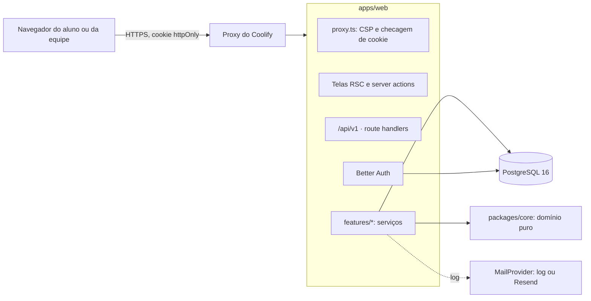

# Arquitetura da plataforma

Monólito modular (ADR 0001): um app Next.js 16 é ao mesmo tempo telas, BFF e API `/api/v1`, sobre um PostgreSQL 16 com RLS forçado. Tudo roda no Coolify do time.

## Camadas

| Camada | Onde | Regras |
|---|---|---|
| Domínio puro | `packages/core` | Sem I/O. Estimativa de domínio, seleção de questão, recomendação, revisão espaçada e datas por fuso. Coberto por testes unitários. |
| Dados | `packages/db` | Schema Drizzle, migrations SQL com RLS e triggers, seeds e `withUser()`. |
| Serviços | `apps/web/src/features/*/service.ts` | Regra de aplicação. Toda consulta pessoal roda em `withUser` **e** filtra pelo dono. |
| Entradas | `app/api/v1/**`, server actions | Validação Zod; identidade só da sessão; contrato de erro `{ code, message, requestId }`. |
| Telas | `app/**/page.tsx`, `components/*` | RSC por padrão; componentes de cliente só onde há interação. |

## Segurança em camadas

1. **`proxy.ts`:** sem cookie de sessão, a área logada nem renderiza. Também monta a CSP por requisição.
2. **`requireUser` e `requireRole`:** sessão válida, e-mail confirmado, papel exigido e 2FA para admin.
3. **Serviço:** filtro explícito pelo dono. É isso que impede admin e revisor, que leem tudo pelo RLS, de verem dados de outros nas próprias telas.
4. **RLS (ADR 0003):** `gutta_app` não tem BYPASSRLS. Sem usuário no contexto, nada pessoal aparece.
5. **Triggers:** o banco corrige a tentativa (`grade_attempt`) e impõe o workflow editorial (`enforce_editorial_transition`). Tentativas, revisões, consentimentos e auditoria são só de inserção.

## Fluxo de uma resposta

1. `GET /api/v1/questions/sessions/:id/next` devolve enunciado e alternativas, sem gabarito.
2. `POST /api/v1/questions/attempts` grava a tentativa com a chave idempotente do cliente. O trigger corrige, o serviço recalcula o domínio do assunto e o evento `question_answered` é registrado.
3. A resposta traz a explicação de cada alternativa, as referências (ou "sem referência cadastrada") e a faixa de domínio.

## Dados

As migrations ficam em `packages/db/migrations`, em ordem:

| Migration | Conteúdo |
|---|---|
| 0000, 0001 | Identidade, catálogo, RLS, workflow editorial |
| 0002 | Campos de bloqueio do 2FA |
| 0003, 0004 | Banco de questões, tentativas, domínio, recomendações |
| 0005, 0006 | Flashcards, agendamentos e revisões |
| 0007, 0008 | Leitura dos próprios eventos (LGPD); recomendações lidas por admin (métricas) |

Os timestamps são sempre `timestamptz` em UTC. "Hoje" e os vencimentos usam o fuso do aluno (`profiles.timezone`, padrão `America/Sao_Paulo`).

## Verificação (estado em 02/11/2026)

| Verificação | Resultado |
|---|---|
| `pnpm lint`, `pnpm format:check`, `pnpm typecheck` | ok |
| Unitários (`packages/core`) | 31 passando |
| Integração (Postgres, RLS e isolamento) | 26 em `packages/db` e 4 nos serviços do app |
| Unitários do app (CSP) | 2 passando |
| `pnpm build` | ok |
| E2E Playwright (desktop e celular, axe WCAG 2.2 AA) | 13 passando |
| Teste de carga (k6, ver `docs/carga/relatorio.html`) | 100 alunos com p95 de 102 ms; teto de cerca de 230 por réplica |
| Imagem Docker e compose (testados localmente) | builda, sobe, aplica migrations e roda como não-root |

## Riscos conhecidos

- **Conteúdo:** nada do que está no seed tem revisão científica. Antes do teste de corredor, o módulo MCH precisa entrar pelo editorial e ser aprovado pelo Hugo (ADR 0005).
- **E-mail:** sem `RESEND_API_KEY` em produção, ninguém confirma a conta. O domínio de envio precisa estar verificado no Resend antes do teste de corredor.
- **Termos e privacidade:** texto em rascunho; falta a revisão jurídica (SPEC D09).
- **Aula interativa:** se o site da aula bloquear iframe (`X-Frame-Options`), o módulo mostra um quadro vazio. Há o link "Abrir a aula em tela cheia", mas falta detectar o bloqueio (ver `docs/ux.md`).
- **Escala:** o rate limit de login fica em memória. Ao ligar a segunda réplica, ele precisa ir para o banco (ADR 0006).

## Próximo passo

O tutor IA (M3 da SPEC e F1 do roadmap) foi deixado para depois de a fundação estar testada, como manda a SPEC §19.2. A sequência sugerida:

1. Interface `AIProvider` com implementação Anthropic e uma de teste.
2. RAG sobre o resumo e as explicações revisadas do módulo, com busca textual do Postgres primeiro e `pgvector` quando o volume pedir.
3. Cota por plano e registro de uso e custo (`ai_usage`).
4. Bateria de 30 casos de avaliação (SPEC §12.3), incluindo prompt injection, pedido clínico real e citação inexistente.

Em paralelo, o pipeline de geração assistida de questões e flashcards, que precisa da revisão humana antes de publicar, já tem a fila editorial pronta para recebê-las.
