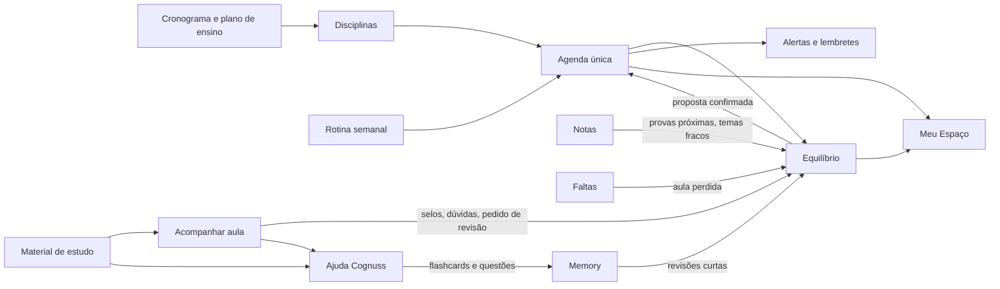
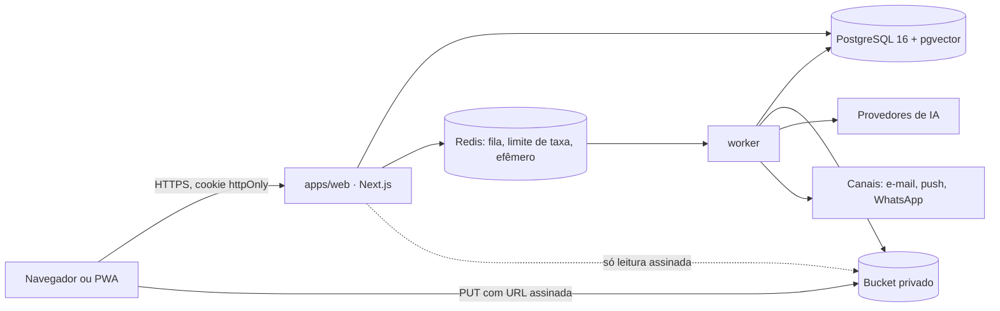

# SPEC DE PRODUTO E ENGENHARIA: Cognuss v2

- **Versão:** 2.0 (rascunho para aprovação), 13/11/2026. Decisões D02, D03, D04, D05 e D07 registradas no mesmo dia (seção 14.1).
- **Status:** proposta. Só vira fonte de verdade depois da aprovação do Fernando, do Dr. Hugo e do Dr. Rafael e do fechamento das decisões da seção 14.
- **Documento de origem:** _COGNUSS: Proposta de Interface e Especificação Funcional. Plataforma de Apoio ao Estudante de Graduação. Parte I_ (Dr. Hugo e Dr. Rafael, 12/11/2026, 56 páginas, 42 figuras). O arquivo `.doc` original não está no repositório (8 MB); as telas foram extraídas para `docs/spec/cognuss-v2/telas/` (Anexo A).
- **Relação com a SPEC v1:** a v1 (`SPEC_Plataforma_Integrada_Estudantes_Saude_v1.md`) descreve o MVP Gutta, já construído. Esta v2 muda o centro do produto e passa a valer para **escopo e produto**. A v1 e o `Engineering_Blueprint.md` continuam valendo para **padrão de engenharia** (RLS, idempotência, testes, definição de pronto).

## 0. Como ler

Cada requisito tem um identificador (`ROT-03`), uma prioridade e, quando preciso, uma marca de origem:

| Marca | Significado |
|---|---|
| (sem marca) | Está no documento de origem. |
| **[ENG]** | Proposta de engenharia desta spec para tornar o requisito construível. Não foi pedida pelos autores; pode ser recusada. |
| **[PEND]** | Depende de uma decisão da seção 14 ou de uma lacuna da seção 15. |

Prioridades: **E** (essencial para a primeira versão utilizável do módulo), **D** (desejável, entra logo depois), **F** (futuro; o próprio documento chama de médio ou longo prazo, ou depende de parecer jurídico).

Na conversão do `.doc`, as figuras saíram fora de lugar, e a numeração das seções do documento se repete. O mapeamento figura × seção do Anexo A foi feito pelo conteúdo de cada figura. Vale conferir.

---

## 1. Resumo executivo

### 1.1 O que muda da v1 para a v2

O MVP Gutta entrega **conteúdo curado pela plataforma**: um curso, uma trilha, módulos com aula interativa, questões, flashcards e tutor sobre o material publicado.

A Cognuss v2 passa a organizar a **vida acadêmica real do aluno**: as disciplinas que ele cursa, os cronogramas e slides dos professores dele, a rotina dele, as faltas e as notas dele. A inteligência artificial trabalha sobre o material que o próprio aluno traz.

| | MVP Gutta (v1) | Cognuss v2 |
|---|---|---|
| Centro do produto | Catálogo editorial | Semestre do aluno |
| Disciplinas | Do catálogo, iguais para todos | Cadastradas pelo aluno, com docentes e cronograma |
| Conteúdo | Publicado pelo editorial | Enviado pelo aluno (slides, provas, resumos) e gerado a partir dele |
| Planejamento | Meta de minutos por dia | Rotina semanal real e motor adaptativo (Equilíbrio) |
| Tutor IA | Só o resumo publicado do módulo | Os materiais selecionados, com fonte e página |
| Ponto de uso diário | Painel "Hoje" e sessão de questões | Meu Espaço e Acompanhar Aula |

O que o MVP construiu não se perde: autenticação, RLS, LGPD, admin, tutor, revisão espaçada e banco de questões são a fundação da v2 (seção 7.1). O catálogo curado vira o **acervo Cognuss**, usado como material complementar (AJU-07).

### 1.2 Diretriz de desenvolvimento

> "A COGNUSS se adapta à vida do estudante, respeitando seu tempo, suas prioridades e seu ritmo de aprendizagem."

Essa frase orienta o módulo de rotina, o tutor de IA, as notificações, os simulados e as recomendações.

### 1.3 Princípios de produto

| # | Princípio | Consequência prática |
|---|---|---|
| P1 | Rotina antes das recomendações | Nada é sugerido antes de o aluno declarar quando pode estudar. |
| P2 | Estudar melhor, não necessariamente mais | Sucesso não é medido por horas ocupadas. A meta de 20 h semanais é só uma referência configurável. |
| P3 | Descanso e lazer são protegidos | Horário pessoal nunca é tratado como disponível. Nenhuma prioridade acadêmica autoriza sozinha a troca. |
| P4 | Toda mudança é uma proposta | O sistema não altera a agenda em silêncio. O aluno aceita, edita, recusa ou pede outra. |
| P5 | Transparência | Cada sugestão diz por que foi feita. Cada resposta da IA diz de onde veio. |
| P6 | Sem culpa | Não existem "fracasso", "atraso pessoal" nem cobrança. Não concluir uma tarefa não é lido como desmotivação. |
| P7 | A agenda não diagnostica | Mensagens refletem a organização da agenda, sem presumir estado emocional nem saúde. |
| P8 | Registro pessoal não é registro oficial | Faltas e notas lançadas pelo aluno nunca aparecem como dado da instituição. |
| P9 | O material é do aluno | Anotações pertencem ao aluno, não ao arquivo. Tudo privado por padrão. |
| P10 | Um fato, um lugar | Um arquivo, um evento ou uma nota existem uma vez e aparecem em vários lugares, sem duplicar. |
| P11 | IA ancorada no material | A IA usa primeiro o que o aluno selecionou, separa o que é complemento e não inventa o que não está lá. |
| P12 | Privacidade desde o desenho | Só o dado necessário e autorizado. Áudio de aula nunca é gravado. |

### 1.4 Métrica norteadora [ENG]

A v1 usa **WALS** (alunos com ao menos uma atividade de aprendizagem ativa na semana). A proposta é manter a WALS e ampliar o que conta como atividade: concluir uma aula acompanhada, concluir uma sessão de estudo planejada, revisar flashcards, responder questões.

Horas estudadas **não** viram métrica de sucesso nem meta de produto (P2). Indicadores de apoio: alunos com cronograma confirmado, propostas de plano aceitas, aulas acompanhadas por semana, materiais transformados em recurso de estudo, retenção D7 e D30.

---

## 2. Escopo

### 2.1 Dentro desta spec (Parte I do documento)

**Público:** alunos de qualquer curso de graduação da área da saúde (decisão D05). A disciplina é cadastrada pelo próprio aluno, então nada depende de a plataforma ter conteúdo do curso dele. O material complementar (AJU-07) só aparece onde o acervo Cognuss tiver conteúdo revisado.

Cadastro inicial, disciplinas e cronogramas, rotina semanal (Meu Tempo), motor Equilíbrio, Meu Espaço e o ambiente da disciplina com nove módulos: Acompanhar Aula (com Áudio Inteligente), Calendário, Material de Estudo, Alertas e Lembretes, Faltas, Notas, Calculadora de Média Final e Ajuda Cognuss.

### 2.2 Citado no documento, mas ainda não especificado [PEND]

Aparecem nas telas ou no texto, sem descrição suficiente para construir. Ficam para a Parte II (decisão D17):

| Item | Onde aparece | O que falta |
|---|---|---|
| Aprender, Organizar, Conectar, Evoluir | Menu principal (T10) | O que cada área contém. |
| Minha Biblioteca (global) | Menu principal (T10) | Diferença para o Material de Estudo de cada disciplina. Hipótese: a mesma biblioteca, sem filtro de disciplina. |
| COGNUSS Pulse | Lista de integrações do Equilíbrio | "Identifica oportunidades de ajuste e apresenta recomendações." Nesta spec vira o cartão de recomendações do Meu Espaço (ESP-08). |
| Simulados, Lâminas digitais | Acessos rápidos (T10) | Conteúdo e funcionamento. |
| Avatar do tutor | Texto do cadastro da rotina | Como é criado e onde aparece (D14). |
| Objetivo "Desenvolver meu currículo" | Cadastro (T02) | O que a plataforma faz de diferente para esse objetivo. |
| Compartilhar materiais com colegas | Regras do Material de Estudo | Regras de compartilhamento e direitos autorais (D20). |

### 2.3 Fora do escopo

Integração com sistemas acadêmicos das instituições, registro oficial de frequência ou nota, gravação de aula, videoconferência, marketplace, pagamentos, app nativo. O painel do professor e as turmas do MVP continuam como estão e não fazem parte desta entrega (D16).

---

## 3. Perfis e permissões

| Perfil | Na v2 |
|---|---|
| Aluno | Dono de tudo o que cadastra, envia, anota e gera. Único perfil com escopo novo nesta spec. |
| Editor e revisor | Mantêm o acervo Cognuss (catálogo do MVP). Sem mudança. |
| Professor | Na v2 o professor é, a princípio, só um **nome** ligado à disciplina do aluno. O papel `teacher` e as turmas do MVP não mudam (D16). |
| Admin | Usuários, catálogo, privacidade, custos e limites de IA. Ganha a visão de uso de armazenamento e de IA por recurso. |

Regra que não muda: a identidade vem da sessão, todo dado do aluno passa por `withUser()` e o RLS falha fechado.

---

## 4. Mapa do produto

### 4.1 Nomes do documento e módulos técnicos

| Nome no documento | Módulo | Seção |
|---|---|---|
| Cadastro inicial | `CAD` | 5.1 |
| Minhas Disciplinas, cronogramas | `DIS` | 5.2 |
| COGNUSS Rotina, Meu Tempo | `ROT` | 5.3 |
| COGNUSS Equilíbrio | `EQU` | 5.4 |
| Meu Espaço (e Pulse) | `ESP` | 5.5 |
| Visão geral da disciplina | `DSC` | 5.6 |
| Acompanhar Aula | `AUL` | 5.7 |
| Ferramenta de Áudio Inteligente | `AUD` | 5.8 |
| Calendário da Disciplina, Minha Agenda | `CAL` | 5.9 |
| Material de Estudo | `MAT` | 5.10 |
| Lembretes da disciplina, Lembretes | `LEM` | 5.11 |
| Faltas | `FAL` | 5.12 |
| Notas, Calculadora de Média Final | `NOT` | 5.13 |
| Ajuda Cognuss, COGNUSS Tutor | `AJU` | 5.14 |
| COGNUSS Memory | `MEM` | 5.15 |

### 4.2 Navegação

**Menu principal (T10):** Meu Espaço, Aprender, Organizar, Conectar, Evoluir, Minha Biblioteca. Só Meu Espaço está especificado (2.2).

**Abas do Meu Espaço:** Visão geral, Rotina semanal, Plano de estudos, Agenda, Meu desempenho.

**Menu da disciplina (T11, T17, T18):** Visão geral, Acompanhar aula, Calendário da disciplina, Material de estudo, Alertas acadêmicos, Meus lembretes, Faltas, Notas (com a Calculadora de Média Final), Ajuda Cognuss. Topo com "Minhas disciplinas" para voltar.

O documento chama os dois itens de lembrete de "Lembretes da disciplina" e "Lembretes" e, mais adiante, recomenda os nomes **Alertas acadêmicos** e **Meus lembretes**. Esta spec adota os nomes recomendados (lacuna L3).

### 4.3 Como os módulos se alimentam



O fluxo de aprendizagem que o documento quer fechar (T16):

**Cronograma → Aula → Anotações → Identificação de dificuldades → Revisão → Avaliação da aprendizagem**, sem aumentar artificialmente a carga de estudo.

---

## 5. Especificação funcional

### 5.1 CAD: cadastro inicial

**Objetivo:** levar o aluno do zero até um Meu Espaço já personalizado, com disciplinas, cronogramas e rotina. Telas: T01, T02, T05.

**Sequência.** O documento mostra três versões (4 passos em T02, outros 4 em T05, 5 passos em T01). Esta spec unifica (lacuna L1):

1. Dados pessoais
2. Perfil acadêmico
3. Disciplinas e cronogramas
4. Minha rotina
5. Preferências de planejamento (opcional, pode pular)
6. Meu Espaço

A conta (e-mail, senha, aceite dos termos, confirmação do e-mail) continua sendo criada antes, pelo fluxo do MVP.

| ID | Requisito | Pri. |
|---|---|---|
| CAD-01 | Dados pessoais: nome completo, e-mail (vem da conta), **CPF** e **telefone com DDI**, os dois obrigatórios (decisão D04). O CPF é validado pelos dígitos verificadores e é único: um CPF, uma conta. Ele é usado para a emissão de nota fiscal, e a tela diz isso. Ter o telefone não autoriza mensagem por WhatsApp; isso continua pedindo consentimento próprio (LEM-11). | E |
| CAD-02 | Perfil acadêmico: curso de graduação, semestre, instituição, campus (opcional), turma (opcional, texto livre como "XIIA"). O curso vem de uma lista de cursos da saúde mantida pelo admin, com a opção "outro" (decisão D05). | E |
| CAD-03 | Objetivo principal, escolha única: reforçar disciplinas, preparar-me para provas, organizar minha rotina, desenvolver meu currículo. Editável depois no Meu Espaço ("Alterar objetivo"). | E |
| CAD-04 | Passo de disciplinas: ver DIS-01 a DIS-06. Exige ao menos uma disciplina para continuar. | E |
| CAD-05 | Passo de rotina: ver ROT. O aluno pode avançar sem atingir a meta de horas. | E |
| CAD-06 | Passo de preferências: ver EQU-01. Tem valores padrão; pular não bloqueia nada. | D |
| CAD-07 | O cadastro é retomável: sair no meio e voltar continua de onde parou. Repetir um passo não duplica dados. **[ENG]** | E |
| CAD-08 | Tudo o que foi informado é editável depois, em Perfil e em Minhas Disciplinas. | E |
| CAD-09 | Indicador de etapas com a etapa atual, as concluídas e "Voltar" sem perda de dados. | E |
| CAD-10 | Proteção do CPF **[ENG]**: guardado cifrado, com um resumo com chave só para garantir a unicidade; mostrado mascarado (`***.***.***-00`); fora de registros, eventos, fila e de qualquer contexto de IA; lido só pelo dono e, com auditoria, pelo admin; incluído na exportação e apagado na exclusão da conta, salvo o que constar em nota fiscal já emitida, que segue o prazo da legislação fiscal. | E |

**Aceite:** um aluno novo chega ao Meu Espaço com as disciplinas, os eventos confirmados do cronograma e a rotina visíveis; se pulou cronograma ou rotina, o Meu Espaço mostra o que falta, sem bloquear.

### 5.2 DIS: disciplinas e cronogramas

**Objetivo:** registrar o que o aluno cursa e transformar o cronograma do professor em eventos. Telas: T02, T10, T11.

| ID | Requisito | Pri. |
|---|---|---|
| DIS-01 | Adicionar disciplina ou unidade curricular: nome (obrigatório), nome curto ("Fisiopato"), um ou mais docentes (texto, em etiquetas), cor e ícone. | E |
| DIS-02 | Enviar o **cronograma** da disciplina: PDF, DOC, DOCX ou XLSX, até 10 MB. | E |
| DIS-03 | Enviar o **plano de ensino** da disciplina, em campo separado do cronograma. | E |
| DIS-04 | Informar o **link de uma planilha Google** como cronograma. A plataforma relê o link e detecta mudanças. **[PEND D09]** | D |
| DIS-05 | A IA extrai do cronograma: datas, horários, tipo (aula, prova, atividade, entrega, prática), tema, docente e local. O resultado aparece numa **tela de conferência**; só vira evento depois de o aluno confirmar. O aluno corrige qualquer campo antes. | E |
| DIS-06 | Do plano de ensino, a IA extrai objetivos de aprendizagem por tema, carga horária, critério de frequência e composição da nota. Esses dados são **sugeridos** como configuração de Faltas e Notas, sempre com confirmação. **[ENG]** | D |
| DIS-07 | Quando o cronograma muda (novo upload ou planilha alterada), a plataforma mostra a diferença (incluído, alterado, removido) e pede confirmação antes de mexer nos eventos. Eventos que o aluno editou à mão são sinalizados, não sobrescritos. | E |
| DIS-08 | Mudança confirmada no cronograma gera sugestão de ajuste da rotina e do plano (nunca ajuste automático). | D |
| DIS-09 | Sem cronograma, o aluno monta os horários de aula à mão na grade (ROT-02). | E |
| DIS-10 | Cartão da disciplina no Meu Espaço: nome, docentes, "Cronograma anexado", progresso (ESP-04), menu de ações. | E |
| DIS-11 | Semestres: toda disciplina pertence a um semestre do aluno. Encerrar o semestre arquiva as disciplinas e mantém os materiais na biblioteca (MAT-14). **[ENG]** | D |
| DIS-12 | Ligação opcional da disciplina do aluno a uma disciplina do acervo Cognuss, para habilitar material complementar (AJU-07). Sugerida pelo nome, confirmada pelo aluno. **[ENG]** | D |

**Regras:**
- A extração nunca cria evento sozinha. Leitura com baixa confiança (data ambígua, horário ausente) é marcada para o aluno resolver.
- O arquivo original fica guardado como material da disciplina (tipo "cronograma" ou "plano de ensino") e pode ser baixado (T11, "Baixar PDF do cronograma").
- Os exemplos do documento usam quatro disciplinas (BMF, MAD, Fisiopato, Anatomia). É exemplo; o número é livre (lacuna L8).

**Aceite:** dado um cronograma em PDF com 15 aulas e 2 provas, o aluno vê a lista extraída, corrige um item, confirma, e os 17 eventos aparecem no calendário da disciplina e na agenda geral, uma vez cada.

### 5.3 ROT: rotina semanal (Meu Tempo)

**Objetivo:** a plataforma saber **quando** o aluno pode estudar, e não só **o que** ele precisa estudar. Acontece depois das disciplinas e antes do primeiro acesso ao Meu Espaço. Telas: T03, T04, T05.

| ID | Requisito | Pri. |
|---|---|---|
| ROT-01 | Grade semanal de domingo a sábado. Intervalo inicial de 1 hora, com opção de 30 ou 15 minutos. Cobre as 24 horas **[ENG]** (as telas mostram de 08:00 a 00:00, o que não deixa registrar sono; lacuna L6), com a janela visível configurável. | E |
| ROT-02 | Os horários de aula vindos do cronograma já aparecem preenchidos. Sem cronograma, o aluno clica na célula e escolhe a disciplina numa lista (T03). | E |
| ROT-03 | Em célula livre, o aluno adiciona: estudo, lazer, academia, trabalho, idiomas, descanso ou atividade personalizada (com nome e cor). | E |
| ROT-04 | Recorrência semanal: cadastra a atividade uma vez e repete nos dias escolhidos (ex.: Academia, ter, qua e qui, 19:00 a 20:00). | E |
| ROT-05 | **Horários fixos protegidos:** aulas (importadas ou preenchidas) ficam identificadas, não são sobrescritas por acidente e nunca são usadas para planejar estudo. | E |
| ROT-06 | **Horários pessoais protegidos:** sono, refeições, lazer, academia, esporte, idiomas e afins nunca entram no planejamento de estudo. | E |
| ROT-07 | O aluno pode bloquear horários sem dizer o motivo. | E |
| ROT-08 | Só os blocos marcados como **Estudo** são horário autorizado para o Equilíbrio. Célula vazia **não** é horário disponível. | E |
| ROT-09 | Meta semanal de estudo extraclasse: sugestão inicial de 20 horas, ajustável (mais e menos). Não é exigência. | E |
| ROT-10 | Demonstrativo acima da grade: meta semanal, estudo planejado, o que falta ou excede. Barra que acompanha o progresso em relação à meta. | E |
| ROT-11 | Mensagem junto da barra: um emoticon e uma frase de incentivo quando se aproxima da meta; uma frase sutil quando se afasta. Nunca cobrança (seção 6.2). | D |
| ROT-12 | Resumo da rotina: aulas (h/sem), estudo extraclasse (h/sem), outras atividades (h/sem), total. | E |
| ROT-13 | Sugestão da Cognuss em texto: "Sua rotina soma 17 horas de estudo. Faltam 3 horas para a sugestão de 20." Com botão "Ajustar rotina". | D |
| ROT-14 | Com a grade preenchida, o botão "Criar plano de estudos com IA" chama o Equilíbrio (EQU-06). | E |
| ROT-15 | "Restaurar" volta a grade ao último estado salvo. | D |
| ROT-16 | Avatar do tutor: o aluno cria e dá um nome ao seu tutor pedagógico. **[PEND D14]** | F |
| ROT-17 | A rotina é editável a qualquer momento em Meu Espaço, Rotina semanal. Mudança gera sugestão de replanejamento (EQU-12), não replanejamento automático. | E |

**Regra contra o próprio protótipo (lacuna L2):** T03 mostra "Meta: semana completa, preencha todos os horários" e um progresso de 0 a 100 por preenchimento. Isso contraria P2 e a regra "nunca preencher todos os horários livres". Nesta spec, o progresso mede a meta de estudo que o aluno escolheu, nunca a ocupação da semana.

**Aceite:** com aulas importadas e três atividades recorrentes, o aluno marca blocos de estudo, vê a soma de horas atualizar na hora, e nenhuma ação de planejamento posterior toca em aula ou horário pessoal.

### 5.4 EQU: Equilíbrio, planejamento acadêmico adaptativo

**Objetivo:** organizar o estudo de forma personalizada, flexível e realista. A função não é preencher horários disponíveis; é encontrar oportunidades viáveis de aprendizagem sem comprometer a qualidade de vida. Telas: T06 a T09.

O Equilíbrio é um **serviço transversal**: Meu Espaço, calendário, Acompanhar Aula, Faltas, Notas e Memory pedem horário a ele; nenhum deles agenda por conta própria.

#### Regras fundamentais (obrigatórias)

| Regra | Comportamento |
|---|---|
| R01 Respeito aos compromissos | Nunca substituir aula, trabalho ou compromisso pessoal sem autorização. |
| R02 Preservação do descanso | Não programar estudo em horário protegido de sono e descanso. |
| R03 Preservação do lazer | Lazer, academia e convivência social não são horário automaticamente disponível. |
| R04 Sessões curtas | Organizar atividades de preferência em blocos de 30 minutos. |
| R05 Flexibilidade de horário | Distribuir entre manhã, tarde e noite conforme a disponibilidade declarada. |
| R06 Pausas | Sugerir intervalo entre sessões consecutivas. |
| R07 Limites de estudo | Respeitar o máximo diário e o semanal definidos pelo aluno. |
| R08 Priorização | Considerar avaliações próximas, dificuldades e relevância do conteúdo. |
| R09 Replanejamento | Reorganizar o que não foi concluído sem acumular obrigações. |
| R10 Autonomia | Pedir confirmação antes de alterar a rotina. |
| R11 Transparência | Explicar por que cada atividade foi sugerida. |
| R12 Privacidade | Usar só informação necessária e autorizada. |

#### Requisitos

| ID | Requisito | Pri. |
|---|---|---|
| EQU-01 | Preferências: período preferido (manhã, tarde, noite, varia), duração da sessão (20, 30, 45 ou 60 min; padrão 30), intensidade (leve: só o essencial; equilibrada: estudo e tempo livre; intensiva: só quando eu pedir) e prioridade (bem-estar, avaliações próximas, maior dificuldade, distribuição entre disciplinas). Padrão: varia, 30 min, equilibrada, bem-estar. Alterável a qualquer momento. | E |
| EQU-02 | Limites de estudo extraclasse por dia e por semana, definidos pelo aluno. | E |
| EQU-03 | Parâmetros da modalidade equilibrada, todos configuráveis: sessão de 30 min; pausa sugerida de 5 a 10 min entre sessões seguidas; no máximo duas sessões seguidas antes de uma pausa maior; conteúdo difícil nos horários que o aluno considera melhores; evitar sessão logo depois de jornada acadêmica longa, salvo preferência expressa; manter períodos livres; permitir dias sem estudo. | E |
| EQU-04 | Esses parâmetros são decisões de produto, não limites fisiológicos. A interface não os apresenta como recomendação de saúde. | E |
| EQU-05 | Priorização por cinco fatores: proximidade de avaliações; dificuldade identificada; importância curricular (pré-requisitos e objetivos essenciais); tempo necessário (tarefa longa é dividida em etapas); disponibilidade real (impede proposta incompatível com a rotina). | E |
| EQU-06 | **Gerar proposta semanal:** usa só horários autorizados (ROT-08), sem sobreposição, dentro dos limites. O resultado é uma proposta; nada entra na agenda antes da confirmação. | E |
| EQU-07 | Diante da proposta, o aluno pode: aceitar tudo, aceitar em parte, editar uma sessão (horário, duração, conteúdo), recusar, pedir outro plano. | E |
| EQU-08 | Cada sessão mostra o motivo em linguagem simples: "Prova de BMF na quinta", "Você marcou este slide como difícil". | E |
| EQU-09 | Quando o conteúdo não cabe no tempo autorizado, a plataforma diz isso e sugere o que priorizar e o que adiar. Não cria sessão fora do autorizado. | E |
| EQU-10 | Três indicadores separados: **tempo disponível** (declarado pelo aluno), **tempo planejado** (sessões confirmadas) e **tempo realizado** (sessões concluídas, registradas por vontade do aluno). Servem para melhorar as recomendações, não para julgar dedicação. | E |
| EQU-11 | Registrar a sessão como feita é opcional e leva um toque. O aluno pode informar que fez só parte. | E |
| EQU-12 | **"Replanejar minha semana"**, disponível a qualquer momento. Passos: identificar a tarefa pendente; verificar se ainda é relevante; procurar novos horários autorizados; priorizar prazos próximos; oferecer reduzir, dividir ou adiar; apresentar a nova proposta para confirmação. | E |
| EQU-13 | No reagendamento o aluno pode escolher um motivo, sem ser obrigado. | D |
| EQU-14 | Tarefa não concluída não se acumula sozinha na semana seguinte. Fica numa lista de pendentes até o aluno decidir. | E |
| EQU-15 | Convite sem alerta negativo: "Sua semana ficou mais ocupada do que o previsto. Quer reorganizar as atividades restantes, priorizando o mais importante?" | E |
| EQU-16 | Indicador **"Minha semana está equilibrada?"** no topo do Meu Espaço, com três estados: rotina equilibrada; semana intensa (muitos compromissos próximos, sugere priorizar); planejamento a revisar (conflito ou tarefa que não cabe). Reflete só a agenda (P7). | D |
| EQU-17 | Comportamentos por situação: muitas provas na semana → reorganizar revisões e priorizar; pouco tempo → sessões curtas e objetivos essenciais; lazer reservado → preserva, sem sugerir troca; atividade não concluída → reagendamento sem penalização; carga acadêmica alta → sugere reduzir atividades complementares; tempo sobrando → atividades opcionais, sem obrigação; mudança de horário → recalcula e pede confirmação. | E |
| EQU-18 | Pedidos de outros módulos: "revisão de 30 minutos" (AUL-22), "revisão da aula perdida" (FAL-08), "plano de revisão para a prova" (CAL-10), "revisão do tema fraco" (NOT-15). Todos viram tarefa e passam pelo mesmo fluxo de proposta e confirmação. | E |
| EQU-19 | Aprendizagem de preferências, só com autorização: perceber horários mais escolhidos, sessões concluídas e reagendamentos recorrentes e **sugerir** mudança de preferência (ex.: da noite para a tarde). | F |
| EQU-20 | A plataforma nunca interpreta tarefa não concluída como desmotivação ou incapacidade, nem em texto, nem em rótulo, nem em dado derivado. | E |

#### Critérios de aceitação do módulo (do documento)

O módulo está funcional quando consegue:

1. Gerar uma proposta semanal usando só horários autorizados.
2. Respeitar compromissos fixos e períodos protegidos.
3. Distribuir sessões de 30 minutos sem sobreposição.
4. Aplicar os limites diário e semanal.
5. Priorizar conteúdo conforme prazo e dificuldade.
6. Permitir edição manual e recusa de sugestões.
7. Replanejar atividades não concluídas sem gerar sobrecarga automática.
8. Distinguir horas disponíveis, planejadas e realizadas.
9. Explicar as recomendações e preservar a privacidade.

Os itens 1 a 5 e 7 viram testes automáticos de propriedade sobre o motor (seção 7.5).

### 5.5 ESP: Meu Espaço

**Objetivo:** deixar de ser um painel de disciplinas e representar a vida acadêmica real do aluno, com compromissos e limites. Usa três fontes: perfil acadêmico, disciplinas com cronograma e disponibilidade semanal. Tela: T10.

| ID | Área | Requisito | Pri. |
|---|---|---|---|
| ESP-01 | Cabeçalho | Saudação, curso e semestre, instituição, campus e turma. Objetivo principal com "Alterar objetivo". | E |
| ESP-02 | Visão do dia | Aulas, estudos, academia e demais compromissos de hoje em ordem cronológica. | E |
| ESP-03 | Tarefas de hoje | Lista com marcação de feito e contador (2/3). Vem das sessões planejadas e dos lembretes com data de hoje. | E |
| ESP-04 | Minhas disciplinas | Cartões com docentes, estado do cronograma e progresso. "Gerenciar disciplinas" e "Adicionar disciplina". A definição de progresso é **[PEND D13]**. | E |
| ESP-05 | Minha rotina semanal | Tempo de estudo planejado em relação à meta (17 h de 20 h), horas de aula, outras atividades, meta. "Ver e editar rotina". A linha "Descanso (média diária)" só aparece se o aluno registrou sono, e só como soma do que ele registrou. | E |
| ESP-06 | Plano de estudos da semana | Conteúdos distribuídos em sessões ("BMF, expressão gênica: 2 sessões"), com marcação e "Iniciar plano de estudos". | E |
| ESP-07 | Meu desempenho | Evolução por disciplina e geral, com "Ver desempenho completo". Depende de D13. | D |
| ESP-08 | Recomendações da Cognuss | Revisões e atividades sugeridas conforme prioridade e disponibilidade, cada uma com motivo. É onde o "Pulse" aparece. | D |
| ESP-09 | Próximos compromissos | Provas, entregas, práticas e eventos, com "Ver agenda completa". | E |
| ESP-10 | Acessos rápidos | Questões, Simulados, Flashcards, Lâminas digitais, Materiais, Tutor IA. Simulados e lâminas dependem de D17. | D |
| ESP-11 | Faltas | Resumo por disciplina, com alerta quando o limite está perto (FAL-07). | D |
| ESP-12 | Equilíbrio | Indicador "Minha semana está equilibrada?" (EQU-16). | D |
| ESP-13 | Estado vazio | Sem cronograma ou sem rotina, cada cartão diz o que falta e leva ao passo certo. Nunca mostra número inventado. | E |

**Regras:**
- "Plano de estudos de hoje" usa os horários que o aluno reservou, não sugestões genéricas.
- O painel distingue progresso no conteúdo, horas planejadas e horas realizadas. Os percentuais das telas são ilustrativos.
- Avisos do tipo "17 h de 20 h" precisam dizer o que é cada número (planejado e meta), para não confundir com realizado (lacuna L9).

### 5.6 DSC: visão geral da disciplina

Tela: T11. Ao clicar numa disciplina, o aluno vê:

| ID | Requisito | Pri. |
|---|---|---|
| DSC-01 | Cabeçalho: nome, docentes, período, descrição curta (do plano de ensino, quando houver). | E |
| DSC-02 | Quatro cartões prioritários: lembretes não lidos, próxima aula (tema, data, hora, sala, docente), faltas (registradas em relação ao limite), nota (média atual e situação). Cada um leva ao módulo. | E |
| DSC-03 | Calendário da disciplina em lista: data, tipo, evento, descrição, docente. "Ver calendário completo". | E |
| DSC-04 | Cronograma original para baixar. | E |
| DSC-05 | Resumo: carga horária total, aulas presenciais, avaliações, atividades. | D |
| DSC-06 | Menu lateral da disciplina (4.2). | E |

Dados, nomes de professores, datas e notas das telas são ilustrativos.

### 5.7 AUL: Acompanhar Aula

**Objetivo:** transformar os slides do professor num caderno digital interativo. É a aposta do documento para o principal ponto de uso diário. Telas: T13 a T16.

**Três momentos:**
- **Antes:** a plataforma identifica o tema no cronograma, mostra os objetivos de aprendizagem e permite anexar slides e outros materiais. Pode oferecer uma revisão introdutória opcional.
- **Durante:** o aluno navega pelos slides, desenha, escreve, destaca, registra dúvidas e consulta o tutor. Tudo salvo aos poucos.
- **Depois:** o aluno avalia a compreensão, classifica a dificuldade, revê os destaques e pode pedir uma revisão ao Equilíbrio.

**Cinco áreas da tela:**

| Área | Função |
|---|---|
| Barra superior | Disciplina, tema, data, horário, docentes e estado da aula. |
| Navegador de slides | Miniaturas, marca dos slides importantes, acesso rápido. |
| Área central | PDF e ferramentas de desenho e marcação. |
| Caderno lateral | Anotações ilimitadas ligadas ao slide selecionado. |
| Painel de aprendizagem | Objetivos, materiais, tutor, importância, dificuldade e conclusão da aula. |

| ID | Requisito | Pri. |
|---|---|---|
| AUL-01 | Abrir a aula a partir do calendário, da visão geral ou da tabela de aulas do Material de Estudo. A página traz tema, objetivos, materiais associados, caderno e tutor. | E |
| AUL-02 | O aluno anexa o PDF dos slides; cada página vira uma tela editável. Outros formatos (PPTX) são convertidos para PDF no servidor. **[ENG]** | E |
| AUL-03 | Navegação por miniaturas, anterior e próximo, zoom, tela cheia, indicador de página (7 de 18). | E |
| AUL-04 | Ferramentas: caneta, marca-texto, borracha, setas, círculos, retângulos, caixas de texto, inserção de imagem. Cor e espessura. Desfazer e refazer. | E |
| AUL-05 | Funciona com mouse, toque e caneta digital (com pressão, quando o aparelho informa). | E |
| AUL-06 | **Camada independente:** as marcações ficam separadas do PDF. O aluno edita, oculta ou exclui sem alterar o arquivo do professor. | E |
| AUL-07 | Salvamento automático, com indicação de "salvo". | E |
| AUL-08 | **Caderno** ao lado de cada slide: linhas que crescem conforme se escreve; texto digitado; listas, tabelas, fórmulas, imagens e esquemas. | E |
| AUL-09 | Escrita à mão no caderno, conforme o aparelho. | D |
| AUL-10 | **Anotação vinculada:** selecionar uma região do slide e criar uma anotação ligada a ela. Clicar na anotação destaca a região. Guarda o identificador do slide e as coordenadas. | D |
| AUL-11 | Busca por palavra-chave nas anotações. | D |
| AUL-12 | Histórico de versões das anotações, com recuperação. | D |
| AUL-13 | **Selo de importância:** sem destaque, importante, alta prioridade. | E |
| AUL-14 | **Selo de dificuldade:** fácil, moderado, difícil. É independente da importância. | E |
| AUL-15 | Os selos valem para o slide inteiro ou para um trecho ou tópico. O aluno muda quando quiser. | E |
| AUL-16 | **Dúvida** (texto opcional) ligada ao slide ou trecho. Entra na lista de dúvidas do tutor (AJU-09). | E |
| AUL-17 | Tutor contextual: "Explique a figura do slide 12", usando o conteúdo disponível e dizendo quando há incerteza. | D |
| AUL-18 | **Concluir aula** (rápido e opcional, nunca uma prova obrigatória): dificuldade geral (fácil, moderada, difícil) e três marcações: compreendi os principais objetivos; ainda tenho dúvidas; quero uma revisão de 30 minutos. Botão "Concluir e gerar resumo da aula". | E |
| AUL-19 | Resumo da aula gerado a partir dos slides, das anotações e dos selos, salvo em Minhas criações (AJU-10). | D |
| AUL-20 | **Lista de revisão automática:** slides importantes, dúvidas e conteúdo difícil reunidos numa lista. | D |
| AUL-21 | Slide importante e difícil tem prioridade maior nas revisões que slide fácil e sem destaque. | E |
| AUL-22 | Pedido de revisão: identifica o conteúdo difícil ou importante, consulta os horários autorizados e apresenta proposta (EQU-18). A revisão pode combinar explicação resumida, slides destacados, anotações, flashcards e questões. | E |
| AUL-23 | **Meu caderno da disciplina:** reúne as anotações de todas as aulas, por data, tema, slide e importância. | D |
| AUL-24 | Exportar PDF com os slides anotados e o caderno, respeitando as permissões do material. | D |
| AUL-25 | **As anotações são do aluno, não do arquivo.** Se o professor trocar a apresentação, as anotações antigas ficam guardadas e a plataforma oferece reassociar à versão nova. | E |
| AUL-26 | Continuidade entre aparelhos: começar no notebook e continuar no tablet ou no celular. | E |
| AUL-27 | Funcionamento offline: acesso aos materiais já baixados e sincronização depois. **[PEND D12]** | F |
| AUL-28 | Privacidade: anotações privadas por padrão; compartilhar só por escolha (D20). | E |
| AUL-29 | Ao final do fluxo, questões de dificuldade variada sobre o tema da aula (avaliação da aprendizagem), geradas pela Ajuda Cognuss (AJU-06). | D |
| AUL-30 | Registrar presença na aula (citado na tabela do menu). Presença marcada não cria falta; ausência leva a FAL-02. | D |

**Estrutura técnica pedida pelo documento:** quatro componentes independentes e integrados: visualizador de PDF, editor de anotações, sistema de classificação da aprendizagem e integração com o Equilíbrio.

**Aceite:** o aluno abre uma aula com PDF de 18 páginas, desenha em duas, escreve no caderno, marca um slide como "importante e difícil", fecha o navegador, abre em outro aparelho e encontra tudo. O PDF original baixado continua idêntico ao enviado.

### 5.8 AUD: Áudio Inteligente

**Objetivo:** transformar a fala do professor em material de estudo, sem criar uma gravação da aula. Tela: T13 (painel direito).

**Este módulo só começa depois de um parecer jurídico (D10).** Motivos na seção 10.3.

**Princípios obrigatórios (do documento):**

| Princípio | Implementação |
|---|---|
| Sem gravação permanente | Nenhum arquivo de áudio é criado ou guardado. Não há download, reprodução nem acesso ao áudio original. |
| Armazenamento temporário | Transcrição parcial e metadados só em memória volátil ou com expiração automática (duração da sessão mais 30 a 60 minutos para gerar materiais). |
| Minimização | Só a fala do professor interessa. Ver lacuna L5. |
| Finalidade específica | Gerar anotações, resumos, slides, mapas, podcasts e materiais de revisão pedidos pelo aluno. |
| Descarte automático | No fim da sessão ou depois de gerar os materiais, transcrição e buffers são apagados de forma irreversível. |
| Consentimento e transparência | O aluno liga a captura de forma explícita. A interface diz que o áudio não será gravado nem disponibilizado. |
| Acesso restrito | Nem aluno, nem professor, nem outro usuário acessa o áudio ou a transcrição bruta. Só os materiais finais chegam ao aluno. |

| ID | Requisito | Pri. |
|---|---|---|
| AUD-01 | Ligar e desligar a captura na tela da aula, com indicador claro de captura ativa e a mensagem: "O áudio não será gravado nem disponibilizado. Apenas o conteúdo será processado temporariamente para gerar seus materiais." | F |
| AUD-02 | Durante a captura: "Gerar anotação agora" e "Resumo parcial". | F |
| AUD-03 | Marcar trecho como importante, dúvida ou revisar, por botão. A marca se liga ao trecho da transcrição temporária, não ao áudio. | F |
| AUD-04 | Depois da captura, o aluno escolhe o que gerar: anotações e resumo, apresentação (slides), podcast narrado com voz sintética, mapa mental ou conceitual, flashcards (com exportação para Anki), questões objetivas e discursivas em três níveis, roteiro de revisão de 30 minutos. | F |
| AUD-05 | "Descartar agora" disponível o tempo todo. | F |
| AUD-06 | No final: lista dos materiais gerados e confirmação de que os dados temporários foram eliminados. | F |
| AUD-07 | Histórico de sessões: aulas processadas e materiais gerados, sem áudio e sem transcrição. Regenerar um material usa as **anotações estruturadas salvas**, não a transcrição (lacuna L5). | F |
| AUD-08 | O tutor recebe só os materiais finais ou um resumo estruturado, nunca a transcrição bruta. | F |
| AUD-09 | Glossário: termos técnicos e definições no contexto da explicação. | F |
| AUD-10 | Alerta de conceito-chave quando o professor enfatiza algo ("isso cai na prova", repetição). | F |
| AUD-11 | Comparação leve com o slide atual: complementos e divergências. | F |
| AUD-12 | Resumo adaptativo: mais detalhe só nas partes marcadas como difíceis. | F |
| AUD-13 | Avançados: comandos por voz ("Cognuss, resume isso"), detecção de estrutura da fala, conexão com aulas anteriores, modo silencioso (só processa e entrega o pacote no final). | F |

**Controles de segurança:** token de sessão curto ligado à sessão do aluno; limite de ativações; monitoramento de volume; isolamento por sessão; registro só de metadados (início, fim, materiais gerados), sem conteúdo.

### 5.9 CAL: calendário da disciplina e agenda

**Objetivo:** um planner editável por disciplina, sincronizado com a agenda geral e com o Equilíbrio, e não uma cópia estática do cronograma. Tela: T17.

| ID | Requisito | Pri. |
|---|---|---|
| CAL-01 | Visões: mensal, semanal, diária e lista cronológica. Na disciplina, também "Planejamento". | E |
| CAL-02 | Edição direta: clicar numa célula cria evento; clicar num evento edita. | E |
| CAL-03 | Tipos: aula, prova, trabalho, atividade ou entrega, revisão, estudo, outro compromisso, lazer ou descanso. Cada tipo com cor própria e legenda. | E |
| CAL-04 | Recorrência: semanal ou em datas específicas. Ao mudar uma ocorrência: só esta, esta e as próximas, ou toda a série. | E |
| CAL-05 | Personalização: cores, etiquetas, descrição, anexos e observações. | D |
| CAL-06 | Importar e atualizar o cronograma (DIS-05, DIS-07). Evento importado guarda o registro original e marca o que o aluno alterou. | E |
| CAL-07 | Evento criado pelo aluno é livremente editável. | E |
| CAL-08 | Chave "Mostrar minha rotina": ver só os eventos da disciplina ou esses eventos dentro da semana completa, sem duplicar nada. | E |
| CAL-09 | Clicar numa **aula** abre o Acompanhar Aula com tema, objetivos e materiais. | E |
| CAL-10 | Clicar numa **prova** mostra os conteúdos previstos e oferece "Pedir plano de revisão" (EQU-18). | E |
| CAL-11 | Clicar numa **sessão de estudo** abre os materiais e atividades escolhidos para aquele horário. | E |
| CAL-12 | Painel lateral: mini calendário do mês, contagem da semana (aulas, provas, entregas, revisões planejadas), próximos eventos. | D |
| CAL-13 | Ações rápidas: novo evento, editar seleção, duplicar semana, excluir evento, replanejar estudos, bloquear horários. | D |
| CAL-14 | **Agenda geral** no Meu Espaço: todas as disciplinas e a rotina no mesmo calendário, com filtros. | E |
| CAL-15 | Compromisso acadêmico e pessoal são visualmente distintos. Os tipos pessoais seguem a classificação da rotina. | E |
| CAL-16 | Prova ou atividade cadastrada em Notas aparece no calendário, e o contrário, sem duplicar (P10). | E |

### 5.10 MAT: Material de Estudo

**Objetivo:** repositório central do conteúdo da disciplina, em que cada arquivo vira um recurso ativo de aprendizagem. Telas: T18, T19.

**Recomendação principal do documento:** não são quatro bibliotecas (conteúdo de aula, material, atividades, provas). É **um repositório único**, em que cada arquivo tem classificações e vínculos:

**Arquivo → Disciplina → Semestre → Professor → Aula ou tema → Tipo de material → Ferramentas de aprendizagem**

Assim o mesmo arquivo aparece na biblioteca, na aula, no planejamento de revisões e na busca, com um único upload.

| ID | Requisito | Pri. |
|---|---|---|
| MAT-01 | Abas: Semestre atual, Semestres anteriores, Minha biblioteca, Favoritos, Lixeira. | E |
| MAT-02 | **Conteúdo de aula:** tabela em forma de planner preenchida pelo cronograma (aula, data, tema, docente), com miniaturas dos anexos e ações (ver, anexar, mais). Visão em tabela e em cartões. É a principal porta de entrada. | E |
| MAT-03 | Ao escolher uma aula, aparecem todos os materiais dela, anexados antes, durante ou depois. Dá para anexar em aula passada. | E |
| MAT-04 | **Anexar material:** formulário com tipo (material de estudo, atividade, prova), período (semestre atual ou anterior), título, professor, tema ou aula, origem (professor, pessoal, colega, Cognuss, internet) e arquivo (PDF, DOCX, PPTX, imagem). | E |
| MAT-05 | Professor e tema vêm em listas com o que já foi cadastrado, com opção de digitar. | E |
| MAT-06 | A IA sugere o tema pelo conteúdo do arquivo; o aluno corrige. | D |
| MAT-07 | Metadados mínimos obrigatórios: disciplina, tipo e título. O resto pode ser sugerido ou preenchido depois. | E |
| MAT-08 | **Semestres anteriores:** atividades, materiais e provas já cursados, por semestre, professor e tema. | D |
| MAT-09 | **Busca** (campo com atalho Ctrl+K) por: palavra no título ou no conteúdo; professor, disciplina, semestre, tema; tipo; data da aula e origem; e por conceito, mesmo sem o termo exato no título. Buscar "inflamação crônica" traz slides, anotações, questões, provas e resumos relacionados. | E (texto), D (conceito) |
| MAT-10 | Ferramentas sobre um arquivo ou uma aula: criar resumo, gerar roadmap (mapas e esquemas), criar flashcards, gerar questões (AJU-02 a AJU-06). | E |
| MAT-11 | **Análise de provas e atividades anteriores:** temas mais frequentes, formatos de questão e competências exigidas. Sempre com a quantidade de documentos analisados e o aviso de que frequência passada não garante cobrança futura. | D |
| MAT-12 | Direcionamento de estudos: sugestões de revisão baseadas nos materiais históricos. | D |
| MAT-13 | Comparar o semestre atual com anteriores: assuntos em comum e diferenças de cronograma. | F |
| MAT-14 | **Biblioteca longitudinal:** ao fim do semestre os materiais continuam disponíveis, salvo exclusão. | E |
| MAT-15 | Identificador único por arquivo, vinculável a várias aulas sem cópia. | E |
| MAT-16 | Controle de versões: substituir um arquivo guardando as anteriores (slides atualizados pelo professor). | D |
| MAT-17 | Privado por padrão. Compartilhar depende de autorização e de direitos autorais (D20). | E |
| MAT-18 | Impedir o compartilhamento indevido de avaliação sigilosa, material sem autorização ou prova em aplicação. Na primeira versão isso se resolve por não haver compartilhamento. **[ENG]** | E |
| MAT-19 | A interface distingue material do professor, material pessoal e conteúdo produzido pela Cognuss. | E |
| MAT-20 | Slides anexados aqui aparecem na aula correspondente do Acompanhar Aula; anotações e selos feitos lá ficam ligados ao material, sem alterar o arquivo. | E |
| MAT-21 | Lixeira com recuperação por 30 dias. Favoritos. **[ENG]** | D |

### 5.11 LEM: alertas acadêmicos, meus lembretes e notificações

**Dois tipos, um mecanismo.** O documento recomenda manter os dois itens no menu, com um único mecanismo de calendário e notificações por baixo. Telas: T20.

| | Alertas acadêmicos | Meus lembretes |
|---|---|---|
| Origem | Gerados do cronograma e das atividades | Criados pelo aluno |
| Conteúdo | Aulas, provas e atividades previstas | Tarefas, leituras, trabalhos, reuniões, prazos |
| Foco | Programação da disciplina | Organização individual |
| Agenda geral | Sincronizado | Sincronizado |

| ID | Requisito | Pri. |
|---|---|---|
| LEM-01 | Criar lembrete: título, descrição, data, horário e categoria. | E |
| LEM-02 | Editar e excluir direto no calendário. | E |
| LEM-03 | Recorrência diária, semanal ou mensal. | D |
| LEM-04 | Prioridade: normal, importante, urgente. | D |
| LEM-05 | Anexos: documentos, imagens e links. | D |
| LEM-06 | Marcar como realizado ou pendente. | E |
| LEM-07 | Busca por título, período, categoria e palavra-chave. | D |
| LEM-08 | **Apenas lembrar** (cria a notificação, sem ocupar tempo) ou **Reservar horário** (cria compromisso com início e fim e bloqueia o período no Equilíbrio). | E |
| LEM-09 | Lembrete ligado a tarefa de estudo oferece "procurar um horário disponível", só a pedido do aluno. | D |
| LEM-10 | "Quando lembrar": antecedência escolhida (30 minutos antes, um dia antes). | E |
| LEM-11 | Canais: dentro da plataforma, push no celular e WhatsApp (com consentimento e integração; D08). O aluno escolhe canal, antecedência e frequência. | E (interno), D (push), F (WhatsApp) |
| LEM-12 | **Horário silencioso** definido pelo aluno. Nada é enviado nesse período; o aviso fica para depois ou só na plataforma. | E |
| LEM-13 | **Sem duplicidade:** um compromisso que aparece na disciplina e no Meu Espaço gera um alerta só. | E |
| LEM-14 | Teto de notificações por dia, para evitar excesso. **[ENG]** | D |
| LEM-15 | Alertas acadêmicos automáticos: próxima aula, prova, entrega, mudança no cronograma aguardando confirmação. | E |
| LEM-16 | Lembretes do Memory: programação de estudo do dia, questão do dia, revisões vencidas, conforme a configuração do aluno. | D |
| LEM-17 | Lembrete para anexar o atestado nos dias de ausência (FAL-06). | D |
| LEM-18 | Os lembretes aparecem na tela principal e na visão geral da disciplina (contador de não lidos). | E |

### 5.12 FAL: Faltas

**Objetivo:** controle pessoal de frequência, simples e visual, com registro em poucos cliques. Não substitui o sistema oficial da instituição. Telas: T21.

Três partes: calendário de faltas, limite de faltas e minhas faltas.

| ID | Requisito | Pri. |
|---|---|---|
| FAL-01 | Configuração da disciplina: carga horária total em horas-aula, frequência mínima exigida (ou limite percentual de faltas), dias de aula e horas-aula por encontro. Os dias vêm do cronograma. | E |
| FAL-02 | Calendário com os dias de aula; clicar num dia registra a ausência, com quantidade de horas-aula perdidas (integral ou parcial) e observação opcional. | E |
| FAL-03 | Indicadores: limite de ausências, faltas registradas, saldo, percentual do limite usado. Exemplo do documento: 80 horas-aula, frequência mínima de 75%, limite de 20, registradas 4, saldo 16. | E |
| FAL-04 | **O limite é configurável.** O exemplo de 25% não é aplicado automaticamente a nenhum curso. | E |
| FAL-05 | Minhas faltas: tabela histórica com data, tema da aula, horas-aula, situação e total. Editar, remover e acrescentar observação. | E |
| FAL-06 | Anexar documento justificativo (atestado). **[PEND D11]**: atestado é dado de saúde. | D |
| FAL-07 | Alertas em limiares configuráveis do limite, como 50%, 75% e 90%. | E |
| FAL-08 | Ao registrar a falta, sugerir os slides, anotações e materiais da aula perdida e oferecer "pedir revisão da aula perdida" (EQU-18). | D |
| FAL-09 | Sem duplicidade: um registro por aula. | E |
| FAL-10 | Considerar as horas-aula reais de cada encontro. | E |
| FAL-11 | Regras separadas para teórico e prático, quando a disciplina tiver. | D |
| FAL-12 | Os registros são preservados quando o cronograma muda. | E |
| FAL-13 | A plataforma distingue ausência registrada pelo aluno de falta contabilizada pela instituição, e deixa claro que justificativa não significa abono. | E |

Unidade: tudo é guardado em **horas-aula**. A tela pode mostrar também em encontros ("2 de 12"), como em T11 (lacuna L10).

### 5.13 NOT: Notas e Calculadora de Média Final

**Objetivo:** não é só uma calculadora; é um instrumento de acompanhamento da aprendizagem. Telas: T12, T22, T23.

O documento descreve "Notas" e "Calculadora de Média Final" em seções separadas, com muita sobreposição (fórmula, pesos, nota mínima, simulação). Esta spec trata como **um domínio com duas entradas no menu** (lacuna L4): Notas (lançar e acompanhar) e Calculadora (configurar e simular, incluindo o semestre).

**Áreas do módulo:** visão geral, atividades, provas, fórmulas, simulador, histórico.

| ID | Requisito | Pri. |
|---|---|---|
| NOT-01 | **Configuração da disciplina:** tipos de avaliação (Prova 1, Prova 2, Atividades, Seminário, Trabalho) com a porcentagem de cada um. Indicador visual de que a soma é 100%. | E |
| NOT-02 | Formas de cálculo: média aritmética simples, média ponderada por pesos, composição por porcentagem. | E |
| NOT-03 | Fórmula personalizada, validada antes de salvar para evitar cálculo errado. | D |
| NOT-04 | Nota mínima de aprovação configurável por disciplina (6,0, 7,0 ou outra). | E |
| NOT-05 | Escalas: 0 a 10, 0 a 100 ou conceitos. Arredondamento configurável. | E (0 a 10), D (demais) |
| NOT-06 | Critérios de recuperação e separação entre média parcial e final. | D |
| NOT-07 | Componentes teórico e prático na mesma avaliação ou disciplina. | D |
| NOT-08 | **Cadastrar avaliação:** nome, tipo (atividade ou prova), data, nota (opcional) e peso. Editar e excluir. Anexar a prova ou atividade e ligar aos temas cobrados. | E |
| NOT-09 | **Nota pendente não é zero.** A média atual considera só o que foi lançado e diz isso. | E |
| NOT-10 | Cálculo automático: média parcial, média final projetada e quanto falta para a nota mínima. | E |
| NOT-11 | **"Quanto preciso tirar?"**: informa a nota necessária nas avaliações restantes para atingir a média desejada. | E |
| NOT-12 | **Média do semestre:** peso (ou porcentagem) de cada disciplina, nota mínima geral opcional, média geral ponderada, situação por disciplina e geral. | D |
| NOT-13 | Simulação integrada: "se eu tirar X na Prova 2 de Fisiopato, minha média do semestre fica Y". | D |
| NOT-14 | Gráficos: notas por avaliação em ordem cronológica com a linha da média mínima; evolução da média acumulada; comparação entre atividades e provas; por unidade ou tema, quando houver avaliações suficientes. | E (primeiro), D (demais) |
| NOT-15 | **Resultado ligado ao conteúdo:** com desempenho baixo num tema, a plataforma localiza slides, anotações e materiais e sugere uma revisão de 30 minutos (EQU-18). O tutor explica erros e gera questões parecidas. | D |
| NOT-16 | Situação visual conforme a nota mínima do aluno: aprovado, em risco, reprovado. Definição de "em risco" na seção 6.4. | E |
| NOT-17 | Histórico de alterações e correções de nota. | D |
| NOT-18 | Resultados por avaliação, categoria, tema e período. | D |
| NOT-19 | Nota lançada pelo aluno nunca é apresentada como registro oficial. | E |
| NOT-20 | Meu Espaço mostra o resumo do desempenho de todas as disciplinas. | D |

**Regras de cálculo:**
- Por disciplina (porcentagem): `média = Σ (nota × porcentagem)`, com a soma das porcentagens igual a 100%.
- Por disciplina (pesos): `média = Σ (nota × peso) / Σ pesos`.
- Do semestre: `média = Σ (média da disciplina × peso da disciplina) / Σ pesos`.
- Nota necessária: `(média desejada × peso total − Σ (nota × peso) já lançados) / peso restante`. Exemplo do documento: média 6,5 com peso 6 já realizado, peso restante 4, média desejada 7,0 → nota necessária 7,75.
- Se a nota necessária passa da nota máxima, a plataforma diz que a média desejada não é mais alcançável com as avaliações restantes; se é menor ou igual a zero, diz que a média já está garantida.

A tela T12 mostra a configuração feita por um **coordenador**, aplicada "ao cálculo das notas dos alunos". O texto diz o contrário: quem configura é o aluno. Vale o texto (lacuna L4).

### 5.14 AJU: Ajuda Cognuss

**Objetivo:** a central em que o aluno transforma seu acervo em recursos de aprendizagem. Não é só um chatbot: é um assistente que conhece o conteúdo que o aluno trouxe. Telas: T24, T25.

É uma **camada de inteligência ligada a toda a plataforma**: abre pelo menu da disciplina e também a partir de um slide, uma anotação, uma questão errada ou uma avaliação com resultado baixo. Um clique transforma um conteúdo difícil em explicação, resumo, mapa, flashcards ou revisão.

**Seis áreas (T25):** Minha biblioteca, Criar com IA, Tutor IA, Material complementar, Minhas criações, Revisões.

| ID | Requisito | Pri. |
|---|---|---|
| AJU-01 | **Criar com IA:** (1) selecionar um ou vários materiais, com busca e filtro por tema; (2) escolher o que criar: resumo, flashcards, mapa mental, roadmap, questões, complementar; (3) nível: básico, intermediário, avançado; (4) instruções adicionais opcionais. | E |
| AJU-02 | **Resumos:** sintético, completo, esquematizado ou comparativo. Identifica conceitos fundamentais, organiza tópicos e aponta os slides ou documentos usados. | E |
| AJU-03 | **Flashcards:** perguntas e respostas (ou lacunas), com nível de dificuldade e marcação do que o aluno já domina. Alimentam a revisão espaçada (MEM). Exportação para Anki. | E |
| AJU-04 | **Mapas mentais e conceituais:** editáveis, relacionando conceitos, mecanismos, causas e consequências. Exportação como imagem ou PDF. | D |
| AJU-05 | **Roadmaps de aprendizagem:** sequência lógica com pré-requisitos, conteúdo essencial, aprofundamento e etapas de revisão. | D |
| AJU-06 | **Questões:** a partir de slides, atividades e provas anteriores, com comentário e indicação do conteúdo usado. Níveis fácil, médio e difícil; objetivas e discursivas. O gabarito não vai ao navegador antes da resposta. | E |
| AJU-07 | **Material complementar dentro da plataforma:** ao estudar um assunto, recomendar itens do acervo autorizado (aulas de reforço, casos clínicos, questões comentadas, vídeos, lâminas digitais), considerando pertinência, nível, dificuldades e disponibilidade. Usa o catálogo do MVP (seção 7.1). | D |
| AJU-08 | **Tutor IA contextualizado:** campo de conversa permanente. Usa os documentos selecionados como fonte principal. Exemplos: "Explique a diferença entre inflamação aguda e crônica usando os slides selecionados"; "Crie dez questões sobre os assuntos que marquei como difíceis". | E |
| AJU-09 | **O que foi registrado na aula muda o resultado:** slide importante → destaque em resumos e revisões; conteúdo difícil → explicações e exercícios extras; dúvida registrada → lista de dúvidas para o tutor; anotação pessoal → entra no material, quando selecionada; objetivo não compreendido → atividades específicas; revisão pedida → material para uma sessão de 30 minutos. | D |
| AJU-10 | **Minhas criações:** tudo o que a IA produz pode ser salvo, editado, renomeado, organizado por tema e reutilizado. Fica ligado à disciplina, ao professor, ao tema e aos documentos de origem. | E |
| AJU-11 | Quando o aluno acrescenta material novo a um tema, a criação ligada a ele é marcada como desatualizada e pode ser regenerada. | D |
| AJU-12 | Exportar criações nos formatos de cada recurso (PDF, imagem, Anki, texto). | D |
| AJU-13 | **Revisões:** lista do que está programado ou sugerido para revisar, com acesso ao material preparado. | D |

**Regras de funcionamento da IA (obrigatórias):**

| Regra | Descrição |
|---|---|
| IA-1 Prioridade às fontes selecionadas | Usa primeiro os documentos indicados pelo aluno. |
| IA-2 Rastreabilidade | Resumos, respostas e questões permitem identificar o arquivo e, quando possível, a página. |
| IA-3 Complementação identificada | Informação que não está nos arquivos aparece separada do conteúdo do professor, com rótulo. |
| IA-4 Preservação do conteúdo | Não inventa informação ausente dos documentos. Diz quando o material não cobre a pergunta. |
| IA-5 Personalização | Considera curso, semestre, disciplina e nível escolhido. |
| IA-6 Controle do aluno | Editar, regenerar, excluir e exportar tudo o que foi produzido. |
| IA-7 Privacidade | Usa os arquivos conforme as permissões definidas. |
| IA-8 Rótulo de origem **[ENG]** | Todo conteúdo gerado leva o selo "Gerado por IA a partir dos seus materiais · sem revisão editorial". Decorre da regra do projeto sobre conteúdo de saúde sem revisão. |
| IA-9 Limites do MVP mantidos **[ENG]** | Não orienta caso clínico real; trata o conteúdo dos arquivos como texto, nunca como instrução; não entrega gabarito antes da tentativa. |

### 5.15 MEM: Memory (revisão espaçada)

O documento cita o Memory em três papéis: recebe os flashcards criados (AJU-03), seleciona revisões para sessões curtas e envia lembretes (LEM-16). O MVP já tem o motor (`packages/core/srs`, tabelas de flashcards, fila de vencidos).

| ID | Requisito | Pri. |
|---|---|---|
| MEM-01 | Flashcards gerados ou criados pelo aluno entram na fila de revisão espaçada, ligados à disciplina e ao tema. | E |
| MEM-02 | O Equilíbrio pede ao Memory as revisões que cabem numa sessão curta (por tempo estimado). | D |
| MEM-03 | Questões geradas (AJU-06) usam o motor de sessão e tentativa do MVP, com correção no servidor. | E |
| MEM-04 | Lembretes do Memory seguem as preferências, o horário silencioso e o teto de LEM. | D |
| MEM-05 | Selos de dificuldade e importância influenciam a ordem dos cartões novos. **[ENG]** | D |

---

## 6. Regras transversais

### 6.1 Confirmação antes de mudar

Vale para todo módulo. Nenhuma destas ações acontece sem o aluno confirmar: criar eventos a partir de cronograma; alterar eventos por mudança no cronograma; criar, mover ou remover sessão de estudo; mudar preferência de planejamento; configurar faltas ou notas a partir do plano de ensino; reassociar anotações a uma nova versão de arquivo.

### 6.2 Tom de voz

| Faça | Não faça |
|---|---|
| "Sua semana ficou mais ocupada do que o previsto. Quer reorganizar?" | "Você está atrasado." |
| "Faltam 3 horas para a sugestão de 20." | "Você não cumpriu sua meta." |
| "Planejamento a revisar: duas tarefas não cabem nos horários disponíveis." | "Você parece sobrecarregado." |
| Oferecer reduzir, dividir ou adiar. | Acumular tarefas ou exibir alertas vermelhos de déficit. |

Palavras proibidas na interface e nas notificações: fracasso, atraso pessoal, culpa, e qualquer leitura de estado emocional, motivação ou saúde. Isso vira uma verificação automática sobre os textos (seção 13).

### 6.3 Rótulos de procedência

Três procedências sempre visíveis: **do professor**, **pessoal** e **produzido pela Cognuss**. Dentro do que a Cognuss produz, duas: **acervo revisado** (editorial) e **gerado por IA** (sem revisão). Conteúdo de demonstração do MVP mantém o selo próprio.

### 6.4 Definições que o documento deixou abertas [ENG]

| Termo | Proposta | Decisão |
|---|---|---|
| Progresso da disciplina | Aulas concluídas no Acompanhar Aula dividido por aulas já ocorridas no cronograma. Sem cronograma, não mostra percentual. | D13 |
| Progresso geral | Média dos progressos das disciplinas, ponderada pelo número de aulas. | D13 |
| "Em risco" (notas) | A média desejada ainda é alcançável, mas a nota necessária nas avaliações restantes é maior que a média das já lançadas ou maior que 80% da nota máxima. | D13 |
| Semana intensa | Duas ou mais avaliações em sete dias, ou soma de aulas e compromissos acima de um limiar configurável. | D15 |
| Jornada acadêmica longa | Quatro ou mais horas-aula seguidas imediatamente antes do horário. | D15 |
| Ocupação por intensidade | Leve usa até 50% das janelas de estudo declaradas; equilibrada, até 75%; intensiva, até 100%, só quando o aluno pede. | D15 |

---

## 7. Arquitetura

A v2 continua sendo o monólito modular do ADR 0001, sobre a mesma base de código (decisão D01). O `Engineering_Blueprint.md` é o padrão; a seção 7.2 mostra, item a item, como a v2 o cumpre e onde se afasta dele.

### 7.1 O que se reaproveita do MVP

| Do MVP | Uso na v2 |
|---|---|
| Better Auth, sessões no banco, 2FA do admin (ADR 0002) | Igual. O cadastro novo (CAD) começa depois da conta criada. |
| `withUser()`, RLS com `FORCE`, papel `gutta_app` sem BYPASSRLS (ADR 0003) | Igual, para toda tabela nova. Passa a valer também para arquivos, busca e filas (7.2). |
| Pacote LGPD: consentimentos por finalidade, exportação, `erase_user`, retenção (ADR 0009) | Estendido: finalidades novas, exclusão dos arquivos no armazenamento, exportação com arquivos (seção 10). |
| `AIProvider`, cota diária, registro de tokens e custo, bateria de avaliação (ADR 0008) | Vira a camada de IA única (7.7). O tutor passa a aceitar materiais do aluno como contexto. |
| Revisão espaçada (`packages/core/srs`), flashcards pessoais, fila de vencidos | É o Memory (MEM). |
| Banco de questões, sessão, tentativa com chave idempotente, correção por trigger | Recebe as questões geradas a partir do material do aluno (privadas, do dono). |
| Catálogo editorial (cursos, disciplinas, assuntos, módulos, questões publicadas) e fluxo de publicação | Vira o **acervo Cognuss**, fonte do material complementar (AJU-07) e dos acessos rápidos. |
| Admin, auditoria, eventos de produto, métricas | Igual, com eventos novos e visão de custo de IA e de armazenamento. |
| Design system (tokens, componentes base), E2E com axe, teste de carga, CI | Igual. A identidade visual continua a do app: tema escuro e vermelho (decisão D03; ADR 0007 e 0010). |
| `MailProvider` | Vira um dos canais do motor de notificações (7.9). |
| Onboarding (ONB-01), painel "Hoje", `student_disciplines`, `exam_dates` | **Substituídos** por CAD, Meu Espaço, `enrolled_disciplines` e `assessments`. Migração na Fase 1. |
| Turmas e painel do professor | Ficam como estão, fora desta entrega (D16). |

### 7.2 Conformidade com o Engineering Blueprint

| Blueprint | Como a v2 cumpre | Desvio ou novidade |
|---|---|---|
| §1 Princípios | Servidor é a fronteira de confiança; um único ponto público; monólito modular; decisões em ADR. | Nenhum. |
| §1.6 e §8 Contrato como fonte de verdade | Os esquemas Zod de `/api/v1` passam a gerar o **OpenAPI 3.1** e os tipos do cliente. Necessário para o modo offline e para um app nativo futuro. | Hoje o MVP não tem OpenAPI (ADR 0001 já previa). Entra na Fase 0. O formato de erro do MVP (`code`, `message`, `requestId`) é mantido; a seção 8 do blueprint é opcional e não se aplica (sem terceiros). |
| §2 Stack | TypeScript ponta a ponta, PostgreSQL, Drizzle, Tailwind com design system próprio, PWA. | Next.js no lugar de NestJS e React separados: desvio já registrado no ADR 0001. |
| §2 Cache e fila | **Redis** entra agora: fila de trabalhos, limite de taxa compartilhado (pendência do ADR 0006) e o armazenamento efêmero do áudio. | Componente novo de infraestrutura. ADR. |
| §2 Armazenamento | **S3 compatível**, bucket privado. Padrão do blueprint: Cloudflare R2; alternativa: MinIO próprio. | Depende de D06 e da residência de dados (§14). ADR. |
| §3 Arquitetura | Camadas `core` (domínio puro) → serviços → entradas. Efeitos colaterais por **eventos de domínio em fila**, com nova tentativa, espera crescente e fila de mortos. | O processo `worker` é novo, da mesma base e da mesma imagem. |
| §4 Monorepo | pnpm workspaces. Pacotes novos em 7.10. | Sem `apps/api` separado (ADR 0001). |
| §5 Deploy | Coolify, Docker, um ponto público, banco e Redis sem porta pública, migrations no start. | Backup e teste de restauração passam a incluir o bucket. Definir RPO e RTO. Ambiente de homologação igual à produção, se ainda não existir. |
| §6 Segurança | Sessão em cookie httpOnly, RBAC no servidor, 2FA do admin, CSP, limite de taxa, gitleaks. **Arquivo só por URL assinada curta, emitida depois da autorização.** | Acrescentar na CI: análise de dependências, análise estática e varredura da imagem, se faltarem. Teste de invasão antes de abrir a v2. |
| §7 Multitenancy | **Não se aplica** como multi-inquilino: o isolamento é por aluno. Os mesmos cuidados valem por dono: prefixo por aluno no bucket, `user_id` no conteúdo dos trabalhos da fila, nas chaves de cache e nos registros. | Se entrar contrato institucional (fase futura), reavaliar com `tenant_id`. |
| §9 UX e design system | Tokens e componentes base próprios; pensado primeiro para tela pequena; navegação em contexto; sem botão inerte; acessibilidade WCAG 2.2 AA. | Textos da interface centralizados por módulo, o que também permite a verificação do tom de voz (6.2). |
| §10 Dados | `uuid`, `timestamptz`, migrations SQL versionadas, restrições e índices revisados. **Exclusão lógica e auditoria** nas entidades sensíveis (materiais, notas, faltas). Retenção definida (seção 10). | Nenhum. |
| §11 Observabilidade | Registros estruturados com `request_id`, sem dado pessoal. Estende para a fila: cada trabalho carrega o `request_id` de origem. Métricas de fila, de custo de IA e de armazenamento. Captura de erros. | Rastreio ponta a ponta do caminho upload → processamento → geração. |
| §12 Qualidade | Pirâmide de testes, testes de autorização e isolamento, CI bloqueando o merge. **Chaves de funcionalidade** por módulo, para entregar aos poucos e desligar rápido. | Chaves em `app_settings`, por módulo da v2. |
| §13 Fluxo | Conventional Commits em português, PR pequeno, ADR por decisão. | Nenhum. |
| §14 Privacidade | Minimização, finalidade, retenção, direitos do titular. **Contrato de tratamento de dados** com cada operador novo (IA, transcrição, voz, mensageria, armazenamento). Residência dos dados a decidir. | Dados de saúde (atestado) e voz de terceiros pedem tratamento próprio (seção 10). |
| §15 Desempenho | Orçamentos na seção 11. **Degradação graciosa:** se a IA, o armazenamento ou o WhatsApp caírem, agenda, notas, faltas e anotações continuam funcionando. | Nenhum. |

### 7.3 Componentes novos



| Componente | Proposta | ADR a escrever |
|---|---|---|
| Armazenamento de arquivos | S3 compatível, bucket privado, chave `u/{user_id}/{file_id}/…`, URL assinada de poucos minutos | 0012 |
| Fila e processo `worker` | Redis com BullMQ; o mesmo código, outro comando de entrada | 0013 |
| Busca | Texto completo do Postgres em português, mais `pgvector` para busca por conceito | 0014 |
| Visualizador e anotações | pdf.js para exibir; camada vetorial própria para marcações; editor de texto rico no caderno; fórmulas com KaTeX | 0015 |
| Conversão de arquivos | LibreOffice sem interface no `worker` (PPTX e DOCX para PDF); miniaturas por página | 0012 |
| Antivírus | Varredura de todo upload antes de ficar disponível | 0012 |
| Notificações | Motor único com canais plugáveis: plataforma, e-mail, push web, WhatsApp | 0016 |
| PWA e offline | Service worker, IndexedDB para materiais baixados e fila de alterações | 0017 |
| Áudio | Transmissão por WebSocket seguro, transcrição com retenção zero, texto só no Redis com expiração | 0018 (depois de D10) |
| Contrato | OpenAPI 3.1 gerado dos esquemas Zod; cliente tipado | 0019 |

As bibliotecas são propostas a validar num experimento curto na Fase 0, conferindo a licença de cada uma antes de adotar (blueprint §9).

### 7.4 Caminho de um arquivo

1. **Pedido de envio.** O servidor confere sessão, cota do aluno, tamanho e tipo, cria o registro em `files` e devolve uma URL assinada de envio.
2. **Envio direto ao bucket.** O arquivo não passa pelo processo web.
3. **Confirmação.** O servidor confere tamanho e resumo criptográfico (o mesmo resumo evita cópia duplicada; MAT-15) e publica o evento `file.uploaded`.
4. **Trabalhos em fila**, cada um idempotente, com novas tentativas e fila de mortos:
   `varrer` → `converter para PDF` (se preciso) → `extrair texto e miniaturas por página` → `indexar para busca` → `pronto`.
5. **Sob demanda:** `extrair cronograma`, `sugerir tema`, `gerar criação`.

O estado de cada arquivo (enviando, processando, pronto, falhou) aparece na interface. Falha de processamento não impede ver nem baixar o original.

**Regras de segurança:** tipo conferido pelo conteúdo e não pela extensão; limite de tamanho por tipo; nenhum arquivo servido do mesmo domínio do app sem `Content-Disposition` seguro; nenhuma URL pública; todo acesso passa por autorização no servidor antes de assinar.

### 7.5 Motor do Equilíbrio

**Proposta [ENG]: a distribuição das sessões é um algoritmo determinístico em `packages/core/planner`, sem I/O e sem modelo de linguagem.** As regras R01 a R07 são garantias, e garantia se prova com teste; um modelo de linguagem não consegue prometer que nunca vai agendar em cima do descanso. A IA entra antes (estimar o tamanho de uma tarefa, sugerir tema) e depois (escrever o motivo em linguagem natural), nunca na decisão de onde cabe cada sessão.

**Entrada:** semana; blocos da rotina (aulas, pessoais, janelas de estudo); eventos datados; preferências e limites; tarefas pendentes (disciplina, tema, minutos estimados, prazo, dificuldade, importância, origem); sessões já confirmadas.

**Passos:**
1. **Montar os horários possíveis:** dividir as janelas de estudo em sessões da duração preferida, com pausas (R06) e no máximo duas seguidas (EQU-03). Tirar tudo o que encosta em aula, compromisso ou horário protegido (R01 a R03). Aplicar a regra da jornada longa e a ocupação por intensidade (6.4), que deixa parte das janelas livre de propósito.
2. **Pontuar as tarefas** pelos cinco fatores (EQU-05). Dividir a tarefa longa em etapas do tamanho da sessão.
3. **Encaixar** da maior prioridade para a menor, no primeiro horário viável antes do prazo, com conteúdo difícil nos períodos preferidos (R05) e equilíbrio entre disciplinas, sem passar dos limites diário e semanal (R07).
4. **Listar o que não coube**, com a sugestão de priorizar ou adiar (EQU-09).
5. **Devolver a proposta**, com os códigos de motivo de cada sessão (R11) e a versão do algoritmo.

A proposta é gravada como `proposed`. Só a confirmação do aluno cria as sessões na agenda (R10). "Pedir outro plano" roda de novo com uma variação controlada do desempate, para o resultado ser reproduzível.

**Testes de propriedade** (com entradas geradas): nenhuma sessão encosta em bloco protegido; nenhuma se sobrepõe; os limites nunca são ultrapassados; nada fora de janela de estudo; mesma entrada, mesma saída; replanejar nunca aumenta o total da semana sozinho.

### 7.6 Agenda única

O documento pede "um único mecanismo de calendário", sem duplicar compromisso. **Proposta [ENG]:** cada fato tem uma tabela dona, e a agenda é **um serviço de leitura** que projeta todas em ocorrências com o mesmo formato.

| Fato | Tabela dona |
|---|---|
| Aula datada, com tema | `lessons` |
| Prova, atividade, entrega | `assessments` |
| Bloco da rotina (aula semanal, pessoal, janela de estudo) | `routine_blocks` |
| Compromisso pessoal datado, lembrete com horário reservado | `calendar_events` |
| Sessão de estudo ou revisão | `study_sessions` |

O calendário da disciplina, a agenda geral, a visão do dia, o Equilíbrio e as notificações leem do mesmo serviço. Uma prova cadastrada em Notas aparece no calendário porque é a mesma linha, e não porque foi copiada (CAL-16).

Recorrência: regra simples (diária, semanal, mensal, datas específicas) com tabela de exceções, o que resolve "só esta, esta e as próximas, toda a série" (CAL-04). Horários guardados em UTC e interpretados no fuso do aluno, como no MVP.

### 7.7 Camada de IA

| Tarefa | Entrada | Saída | Observação |
|---|---|---|---|
| Extrair cronograma | PDF, DOCX ou XLSX; ou planilha | Lista de eventos em formato validado | Sempre revisada pelo aluno. Nunca escreve direto na agenda. |
| Extrair plano de ensino | Documento | Objetivos, carga horária, critérios | Vira sugestão de configuração. |
| Sugerir tema de um arquivo | Texto do arquivo e temas da disciplina | Tema e confiança | O aluno corrige. |
| Resumo, mapa, roadmap | Trechos selecionados, com página | Conteúdo estruturado com referências | Regras IA-1 a IA-9. |
| Flashcards e questões | Idem | Itens validados, com fonte | Gabarito fica no servidor. |
| Tutor | Trechos recuperados e histórico curto | Resposta com fontes | Evolução do tutor do MVP. |
| Análise de provas | Provas e atividades do aluno | Frequência por tema, com contagem de documentos | Com aviso de limitação. |
| Motivo de uma sessão | Códigos de motivo do motor | Uma frase | Pode ser texto fixo por código; a IA é opcional. |

**Regras de engenharia:**
- Tudo passa pelo `AIProvider`; nenhuma chamada direta a provedor fora dele. Modelo por tarefa definido em configuração. O provedor continua o do MVP; transcrição, voz e vetores de busca são escolhidos na fase de cada um (D07).
- Saída sempre em formato validado por esquema; saída inválida é refeita ou descartada, nunca mostrada.
- O conteúdo dos arquivos entra como **dado**, em bloco separado das instruções. Um arquivo que diga "ignore as regras" é tratado como texto (IA-9).
- Recuperação de trechos roda dentro de `withUser()`: a busca por conceito nunca enxerga material de outro aluno.
- Cada chamada grava modelo, tokens, custo e recurso em `ai_usage`, por aluno. O mecanismo de cota por aluno e por recurso existe desde o início, mas **fica sem teto durante o período de QA** (decisão D07). Os tetos são definidos depois, com o consumo medido.
- Rede de proteção enquanto não há teto **[ENG]**: o admin vê o gasto total e por recurso, recebe alerta ao passar de um valor configurável e pode desligar cada recurso de IA na hora. Alerta não bloqueia aluno; serve para um defeito não gastar sem ninguém ver.
- Trabalhos longos (gerar, extrair) rodam na fila, com estado visível e cancelamento.
- A bateria de avaliação do tutor ganha casos novos: fidelidade ao material, citação de página, recusa do que não está no material, injeção por documento. Roda antes de abrir cada recurso e a cada troca de modelo ou de instrução.
- O custo por aluno é desconhecido hoje. Ele é medido durante o QA, e os tetos saem desses números (D07, D18).

### 7.8 Anotações e sincronização

- A marcação de cada página é um documento vetorial próprio, ligado a `(aluno, material, versão, página)`, com coordenadas normalizadas de 0 a 1 (independem do zoom e do aparelho).
- Salvamento automático por página, com número de revisão. O cliente guarda as alterações numa fila local e envia com chave idempotente.
- **Conflito entre aparelhos [ENG]:** vence a última gravação por página, e a versão perdida vai para o histórico (AUL-12), de modo que nada some. Edição simultânea da mesma página em dois aparelhos é rara para um único aluno; se virar problema, o ADR 0015 reavalia uma estrutura de fusão automática.
- **Reassociação (AUL-25):** quando o arquivo ganha versão nova, o `worker` compara o texto de cada página antiga com as novas e sugere o par mais parecido. O aluno confirma. Anotações sem par ficam guardadas em "páginas da versão anterior".
- Exportar PDF anotado: gerado no `worker`, entregue por URL assinada.

### 7.9 Notificações

Um motor só: quem quer avisar publica um evento com **chave de deduplicação** (`tipo + alvo + horário`), e o motor decide canal e momento a partir das preferências do aluno, do horário silencioso e do teto diário.

- Canais: plataforma (sempre), e-mail (já existe), push web, WhatsApp.
- Push web no iPhone e no iPad exige a PWA instalada na tela inicial; a interface precisa explicar isso.
- WhatsApp exige conta comercial, modelos de mensagem aprovados e consentimento registrado por finalidade (D08).
- Cada envio grava canal, estado e tentativa. Falha de um canal não derruba os outros.
- Agendamento por trabalho com atraso na fila; reagendar um evento cancela e recria o trabalho.

### 7.10 Estrutura do repositório

```
apps/web/                 telas, /api/v1, server actions (como hoje)
apps/web/src/features/    + academics, schedule, routine, planner, agenda,
                            lesson, materials, reminders, attendance, grading, assist
apps/worker/              consumidores da fila (novo; mesma imagem, outro comando)
packages/core/            + planner (Equilíbrio), grading (médias e simulação),
                            attendance (limites), recurrence, agenda (projeção)
packages/db/              schema, migrations, RLS, withUser (como hoje)
packages/contracts/       esquemas Zod de /api/v1 e OpenAPI gerado (novo)
packages/ai/              AIProvider, instruções, esquemas de saída, avaliação (extraído do tutor)
```

Tudo o que é cálculo (médias, nota necessária, saldo de faltas, recorrência, planejamento) fica em `packages/core`, sem I/O, com teste unitário.

---

## 8. Modelo de dados

Modelo lógico. Toda tabela abaixo tem `id uuid`, `owner_id` (o aluno), `created_at` e `updated_at` em `timestamptz`, RLS com `ENABLE` e `FORCE`, e política `owner_id = current_setting('app.user_id')`. Tipos, índices e restrições são definidos nas migrations de cada fase.

### 8.1 Vida acadêmica

| Tabela | Campos essenciais | Regras |
|---|---|---|
| `student_profiles` (estender) | `cpf_encrypted`, `cpf_hash` (único), `phone`, `campus?`, `class_group?`, `main_goal`, `onboarding_step` | CPF e telefone obrigatórios (D04). CPF nunca em claro no banco (CAD-10). |
| `student_terms` | `label` ("2026.2"), `starts_on`, `ends_on`, `is_current` | Um atual por aluno. |
| `enrolled_disciplines` | `term_id`, `name`, `short_name`, `color`, `icon`, `catalog_discipline_id?`, `workload_hours?`, `archived_at?` | Substitui `student_disciplines`. |
| `discipline_teachers` | `discipline_id`, `name` | Texto livre; alimenta as listas de seleção. |
| `discipline_topics` | `discipline_id`, `name`, `order_index`, `catalog_topic_id?` | Temas do aluno, vindos do cronograma ou criados à mão. |
| `learning_objectives` | `discipline_id`, `topic_id?`, `lesson_id?`, `text`, `source` | Do plano de ensino ou do aluno. |

### 8.2 Cronograma e agenda

| Tabela | Campos essenciais | Regras |
|---|---|---|
| `schedule_sources` | `discipline_id`, `kind` (upload, planilha), `material_id?`, `url?`, `content_hash`, `last_checked_at`, `status` | Uma ou mais por disciplina. |
| `schedule_imports` | `source_id`, `status` (proposed, confirmed, rejected), `extracted` (jsonb), `diff` (jsonb), `confirmed_at?` | Guarda o que a IA leu e o que o aluno confirmou. |
| `lessons` | `discipline_id`, `starts_at`, `ends_at`, `topic_id?`, `title`, `teacher_id?`, `room?`, `class_hours`, `component` (teórica, prática), `origin` (importada, manual), `original` (jsonb), `modified_by_student`, `status` | Uma por encontro. |
| `routine_blocks` | `weekday`, `start_time`, `end_time`, `kind` (aula, estudo, pessoal), `category?`, `label`, `discipline_id?`, `protected`, `valid_from`, `valid_until?` | Não se sobrepõem. Só `estudo` é autorizado para o motor. |
| `calendar_events` | `discipline_id?`, `type`, `title`, `starts_at`, `ends_at?`, `all_day`, `blocks_time`, `recurrence?`, `tags`, `notes` | Compromissos e lembretes com horário. |
| `calendar_event_exceptions` | `event_id`, `occurrence_date`, `change` (jsonb) ou `cancelled` | Edição de uma ocorrência. |
| `reminders` | `target_type`, `target_id?`, `title`, `due_at`, `lead_minutes`, `priority`, `category`, `mode` (lembrar, reservar), `done_at?`, `recurrence?` | "Reservar" cria `calendar_events`. |
| `notification_preferences` | `channel`, `enabled`, `quiet_from`, `quiet_until`, `daily_cap`, por categoria | Uma linha por canal e categoria. |
| `notifications` | `dedupe_key` (único por aluno), `type`, `payload`, `scheduled_for`, `read_at?` | Sem duplicidade (LEM-13). |
| `notification_deliveries` | `notification_id`, `channel`, `status`, `attempt`, `sent_at?`, `error?` | Só inserção. |
| `push_subscriptions` | `endpoint`, `keys`, `device_label`, `revoked_at?` | Por aparelho. |

### 8.3 Planejamento (Equilíbrio)

| Tabela | Campos essenciais | Regras |
|---|---|---|
| `planning_preferences` | `preferred_period`, `session_minutes`, `intensity`, `priority`, `daily_limit_minutes`, `weekly_limit_minutes`, `weekly_goal_minutes`, `break_minutes`, `max_consecutive`, `learn_patterns` | Uma por aluno. |
| `study_tasks` | `discipline_id`, `topic_id?`, `lesson_id?`, `title`, `estimated_minutes`, `due_at?`, `origin` (aula, falta, prova, nota, aluno, memory), `difficulty?`, `importance?`, `status` | A demanda do motor. Não se acumula sozinha (EQU-14). |
| `plan_proposals` | `week_start`, `status` (proposed, accepted, partly_accepted, rejected, superseded), `algorithm_version`, `input_snapshot`, `unplaced` (jsonb) | Rastreável e reproduzível. |
| `study_sessions` | `proposal_id?`, `task_id?`, `starts_at`, `ends_at`, `status` (proposed, confirmed, done, partly_done, skipped, rescheduled), `reason_codes`, `done_minutes?` | Só `confirmed` em diante aparece na agenda. |
| `reschedule_log` | `session_id`, `reason?`, `from`, `to` | Motivo opcional (EQU-13). |

### 8.4 Materiais

| Tabela | Campos essenciais | Regras |
|---|---|---|
| `files` | `storage_key`, `sha256`, `mime`, `size_bytes`, `status` (uploading, scanning, processing, ready, failed, quarantined), `page_count?` | Um por conteúdo; o resumo evita cópia. |
| `materials` | `title`, `type` (estudo, atividade, prova, cronograma, plano de ensino, criação), `origin` (professor, pessoal, colega, cognuss, internet), `term_id?`, `current_version_id`, `favorite`, `deleted_at?` | Unidade lógica; exclusão lógica com lixeira. |
| `material_versions` | `material_id`, `file_id`, `version`, `replaced_at?` | Histórico (MAT-16). |
| `material_links` | `material_id`, `discipline_id?`, `lesson_id?`, `topic_id?`, `teacher_id?` | Um material, vários vínculos (P10). |
| `material_pages` | `version_id`, `page`, `text`, `thumbnail_key`, `search` (tsvector) | Texto por página, para busca e citação. |
| `material_chunks` | `version_id`, `page_from`, `page_to`, `text`, `embedding` (vector) | Busca por conceito e contexto da IA. |

### 8.5 Aula

| Tabela | Campos essenciais | Regras |
|---|---|---|
| `slide_annotations` | `material_id`, `version_id`, `page`, `layer` (jsonb), `revision` | Único por aluno, versão e página. |
| `slide_annotation_history` | `annotation_id`, `revision`, `layer`, `saved_at` | Retenção configurável. |
| `notebook_entries` | `lesson_id?`, `discipline_id`, `material_id?`, `page?`, `region?` (jsonb), `content` (jsonb), `plain_text`, `search` | O caderno. A região liga a anotação ao slide. |
| `notebook_entry_history` | `entry_id`, `revision`, `content`, `saved_at` | Histórico (AUL-12). |
| `content_marks` | `target_type` (slide, região, anotação, tema), `target_ref`, `importance`, `difficulty`, `doubt?` | Os selos. Alimentam prioridade. |
| `lesson_progress` | `lesson_id`, `attended?`, `overall_difficulty?`, `understood_goals?`, `has_doubts?`, `wants_review?`, `concluded_at?` | "Concluir aula". |
| `capture_sessions` | `lesson_id`, `started_at`, `ended_at?`, `discarded_at`, `artifacts` | **Só metadados.** Áudio e transcrição nunca chegam ao Postgres. |

### 8.6 Notas e faltas

| Tabela | Campos essenciais | Regras |
|---|---|---|
| `grading_schemes` | `discipline_id`, `method` (simples, pesos, percentual, fórmula), `formula?`, `scale`, `min_grade`, `rounding`, `recovery` (jsonb) | Um por disciplina. Fórmula validada por analisador próprio, nunca executada como código. |
| `assessments` | `discipline_id`, `name`, `kind` (prova, atividade, trabalho, seminário), `component?`, `due_at?`, `weight?`, `percent?`, `max_grade`, `grade?`, `material_id?` | `grade` nulo é pendente, não zero. Dona do fato "prova" na agenda. |
| `assessment_topics` | `assessment_id`, `topic_id`, `score?` | Liga resultado a conteúdo (NOT-15). |
| `grade_history` | `assessment_id`, `old_grade`, `new_grade`, `changed_at` | Só inserção. |
| `term_grading` | `term_id`, `discipline_id`, `weight`, `min_overall?` | Média do semestre. |
| `attendance_rules` | `discipline_id`, `component?`, `total_class_hours`, `min_attendance_pct`, `alert_thresholds` | Por componente, quando houver. |
| `absences` | `lesson_id`, `class_hours`, `note?`, `justification_material_id?` | Única por aula. Sobrevive à troca de cronograma. |

### 8.7 IA e criações

| Tabela | Campos essenciais | Regras |
|---|---|---|
| `ai_jobs` | `feature`, `status`, `input_refs`, `error?`, `started_at`, `finished_at?` | Estado visível ao aluno. |
| `creations` | `type` (resumo, flashcards, mapa, roadmap, questões, roteiro), `level`, `title`, `content` (jsonb), `discipline_id?`, `topic_id?`, `stale`, `ai_generated` | "Minhas criações". Sempre com o selo de IA. |
| `creation_sources` | `creation_id`, `material_id`, `version_id`, `pages` | Rastreabilidade (IA-2). |
| `tutor_conversations`, `tutor_messages` (estender) | `scope` (módulo, materiais, aula, slide), `source_refs` | O tutor do MVP ganha contexto do aluno. |
| `ai_usage` (generalizar a partir de `tutor_messages`) | `feature`, `model`, `input_tokens`, `output_tokens`, `estimated_cost` | Só inserção. Base das cotas. |
| `flashcards`, `questions` (estender) | `owner_id`, `enrolled_discipline_id?`, `topic_ref?`, `creation_id?` | Itens privados gerados entram no motor existente. |

**Índices que importam:** ocorrências por aluno e intervalo de datas; materiais por disciplina, tipo e semestre; `tsvector` e `vector` de páginas e trechos; `files` por `sha256`; notificações por `dedupe_key`; sessões por aluno e semana.

---

## 9. Contratos de API

Mesmas regras do MVP: `/api/v1`, entrada validada por Zod, identidade só da sessão, erro `{ code, message, requestId }`, paginação por cursor, chave idempotente em toda escrita que o cliente possa repetir (obrigatória nas que sincronizam offline).

| Recurso | Rotas principais |
|---|---|
| Cadastro | `GET/PATCH /me/profile`, `GET/PATCH /me/onboarding` |
| Semestres e disciplinas | `GET/POST /terms`, `GET/POST /disciplines`, `GET/PATCH/DELETE /disciplines/:id`, `GET /disciplines/:id/overview` |
| Cronograma | `POST /disciplines/:id/schedule-sources`, `GET /schedule-imports/:id`, `PATCH /schedule-imports/:id` (corrigir), `POST /schedule-imports/:id/confirm` |
| Rotina | `GET/PUT /routine` (grade inteira), `POST/PATCH/DELETE /routine/blocks` |
| Agenda | `GET /agenda?from&to&discipline&types`, `POST/PATCH/DELETE /events`, `POST /events/:id/exceptions` |
| Aulas | `GET /lessons/:id`, `PATCH /lessons/:id`, `POST /lessons/:id/conclude` |
| Equilíbrio | `GET/PUT /planning/preferences`, `POST /planning/proposals`, `GET /planning/proposals/:id`, `POST /planning/proposals/:id/accept`, `POST /planning/replan`, `PATCH /study-sessions/:id`, `GET /planning/summary` (disponível, planejado, realizado) |
| Arquivos e materiais | `POST /files` (pedir envio), `POST /files/:id/complete`, `GET /files/:id/url`, `GET/POST /materials`, `PATCH/DELETE /materials/:id`, `POST /materials/:id/versions`, `GET /search?q&filters` |
| Anotações | `GET/PUT /materials/:id/pages/:n/annotations`, `GET/POST/PATCH/DELETE /notebook`, `PUT /marks`, `GET /disciplines/:id/notebook`, `POST /materials/:id/export` |
| Lembretes e notificações | `GET/POST/PATCH/DELETE /reminders`, `GET /notifications`, `POST /notifications/:id/read`, `GET/PUT /notification-preferences`, `POST/DELETE /push-subscriptions` |
| Faltas | `GET/PUT /disciplines/:id/attendance-rules`, `GET/POST /disciplines/:id/absences`, `PATCH/DELETE /absences/:id` |
| Notas | `GET/PUT /disciplines/:id/grading-scheme`, `GET/POST /disciplines/:id/assessments`, `PATCH/DELETE /assessments/:id`, `POST /grading/simulate`, `GET/PUT /terms/:id/grading` |
| Ajuda Cognuss | `POST /assist/creations` (cria o trabalho), `GET /assist/jobs/:id`, `GET/PATCH/DELETE /creations/:id`, `POST /creations/:id/regenerate`, `POST /tutor/conversations`, `POST /tutor/conversations/:id/messages` |
| Áudio | `POST /capture/sessions` (token curto), WebSocket da sessão, `POST /capture/sessions/:id/discard`, `POST /capture/sessions/:id/artifacts` |

Simulações de nota e resumos de falta são cálculo puro: a mesma função de `packages/core` roda no servidor e, para resposta imediata, no navegador.

---

## 10. Privacidade, segurança e conformidade

### 10.1 LGPD: o que a v2 acrescenta

| Tema | O que muda |
|---|---|
| CPF | Obrigatório (D04). Finalidade: emissão de nota fiscal. A política pública e o RIPD declaram essa finalidade e a base legal. Dois pontos para a revisão jurídica e o contador: (1) o CPF é pedido no cadastro, antes de existir cobrança, e o princípio da necessidade pode pedir que ele só seja exigido na primeira compra; (2) por quanto tempo o CPF de uma nota já emitida precisa ficar guardado depois que a conta é excluída. Proteções em CAD-10. |
| Telefone | Obrigatório (D04). Usado para contato e, com consentimento separado, para o WhatsApp. |
| Dados novos | Rotina pessoal (horários de sono, trabalho, lazer), faltas, notas, arquivos, anotações. A rotina revela hábitos: é dado pessoal e fica só com o aluno. |
| Finalidades e consentimentos novos | Processamento dos materiais por IA (estende `ai_tutor`); captura de áudio; WhatsApp; aprendizagem de padrões de uso (EQU-19); anexos sensíveis. Cada um separado, revogável em Privacidade. |
| Operadores novos | Armazenamento, transcrição, voz sintética, vetores de busca, mensageria. Contrato de tratamento com cada um, e a política pública lista todos. |
| Transferência internacional | Vale o que o ADR 0009 já decidiu para o tutor: consentimento específico antes de qualquer envio. |
| Exclusão | `erase_user` passa a disparar a remoção dos objetos no bucket e das chaves no Redis, com confirmação registrada. Sem isso, a exclusão fica incompleta. |
| Exportação | Inclui os arquivos e as anotações, em pacote compactado gerado na fila. |
| Retenção | Prazos para lixeira (30 dias), histórico de anotações, arquivos de semestres antigos e criações. Configuráveis em `app_settings`, como hoje. |
| RIPD e registro das operações | Atualizar `docs/lgpd/` com os tratamentos novos. |

### 10.2 Dado sensível: atestados (D11)

Atestado médico é dado de saúde. Recomendação: na primeira versão, o aluno só marca "tenho justificativa" e escreve uma observação, sem enviar o documento. Se o upload for aprovado: consentimento específico, arquivo fora do alcance de toda função de IA e da busca, e acesso registrado em auditoria.

### 10.3 Áudio de aula (D10)

Três pontos precisam de parecer jurídico **antes** de qualquer código:

1. **A voz do professor é dado pessoal de um terceiro** que não tem contrato com a Cognuss. O documento propõe "execução de contrato ou interesse legítimo" como base legal; execução de contrato não alcança o professor, e interesse legítimo pede um teste de balanceamento documentado.
2. **Direito autoral sobre a aula.** A Lei 9.610/98, art. 46, IV, permite ao aluno o apanhado de lições para uso próprio e veda a publicação sem autorização de quem as ministrou. Gerar apresentação e podcast a partir da fala precisa ser avaliado à luz disso, mesmo sendo para uso pessoal.
3. **Regras da instituição.** Muitas proíbem captar áudio em sala. A plataforma precisa, no mínimo, avisar o aluno de que a responsabilidade de ter autorização é dele.

Além disso, "só a fala do professor é processada" não é uma garantia técnica possível com o microfone do aparelho do aluno (lacuna L5). O que dá para prometer: não identificar quem fala, não guardar o áudio e descartar a transcrição.

### 10.4 Segurança de aplicação

| Risco | Mitigação |
|---|---|
| Arquivo malicioso | Varredura antes de liberar; tipo conferido pelo conteúdo; conversão em processo isolado, sem rede. |
| Acesso direto a arquivo | Bucket privado; URL assinada curta, emitida só depois da autorização (blueprint §6). |
| Vazamento entre alunos na busca ou na IA | Recuperação dentro de `withUser()`; RLS em páginas e trechos; teste de isolamento por recurso. |
| Injeção por documento | Conteúdo como dado; saída validada; casos na bateria de avaliação. |
| Link de planilha usado para atacar a rede interna | Lista fechada de domínios permitidos; sem seguir redirecionamento para fora dela; tempo e tamanho limitados. |
| Gabarito de questão gerada | Nunca serializado antes da tentativa; correção no servidor (regra do projeto). |
| Abuso de IA e de armazenamento | Cota por aluno e por recurso; limite de taxa no Redis; alerta de custo para o admin. |
| Fórmula personalizada | Analisador de expressões com gramática fechada; nunca `eval`. |
| Sessão de áudio | Token curto ligado à sessão; isolamento por sessão; registros só com metadados. |
| XSS em caderno e criações | Conteúdo rico guardado como estrutura, renderizado com lista fechada de elementos; CSP do MVP mantida. |

---

## 11. Requisitos não funcionais

| Tema | Meta proposta |
|---|---|
| Leitura comum (agenda, visão geral, notas) | p95 abaixo de 300 ms no servidor; tela densa (Meu Espaço) abaixo de 1 s (blueprint §15) |
| Gerar proposta do Equilíbrio | Abaixo de 1 s para uma semana (é cálculo local) |
| Abrir uma aula com PDF de 50 páginas | Primeira página visível em até 2 s em rede comum; as demais sob demanda |
| Traço da caneta | Sem atraso perceptível; o desenho não espera o servidor |
| Processar um arquivo de 10 MB | Pronto para busca em até 2 minutos; estado visível |
| Geração por IA | Sempre em segundo plano, com estado; nunca trava a tela |
| Disponibilidade do núcleo | Agenda, notas, faltas e anotações funcionam com IA, armazenamento ou WhatsApp fora do ar |
| Acessibilidade | WCAG 2.2 AA, com axe no E2E. As ferramentas de desenho têm alternativa por teclado para navegar, marcar selo e anotar em texto |
| Aparelhos | Celular (consulta e lembretes), notebook e tablet com caneta (Acompanhar Aula). Navegadores atuais, incluindo Safari no iPad |
| Idioma e fuso | Português do Brasil; textos centralizados; fuso do aluno |
| Limites iniciais | Cronograma até 10 MB (do documento). Demais arquivos e espaço por aluno a definir em D06 |
| Escala | Refazer o teste de carga com upload, fila e agenda antes do piloto; rever o ADR 0006 |

---

## 12. Fases e backlog

A ordem segue as dependências: a agenda vem antes do planejamento; o repositório de arquivos vem antes do Acompanhar Aula e da IA. Cada fase só fecha com os critérios de saída atendidos. O calendário e o corte para o piloto são decisão dos sócios (D19); o roadmap público precisa ser atualizado para refletir esta spec.

### Fase 0: preparação

- Aprovar esta spec e fechar as decisões que ainda bloqueiam (D01 e D06).
- ADRs 0012 a 0019 (7.3).
- Infraestrutura: bucket, Redis, `worker`, `pgvector`, chaves de funcionalidade, OpenAPI gerado.
- Experimentos curtos: extração de cronograma com 20 cronogramas reais (medir acerto e custo); visualizador com caneta no iPad e em tablet Android.
- Adaptar as telas de referência ao tema escuro e vermelho do app (D03): paleta de categorias para a grade e o calendário (disciplinas e tipos de evento), nos temas escuro e claro, com contraste AA.

**Saída:** um arquivo sobe, é processado e fica pesquisável por um aluno e invisível para outro, com teste; o consumo de IA já é registrado por aluno e por recurso.

### Fase 1: fundação da vida acadêmica

`CAD`, `DIS` (upload e extração com conferência), `ROT`, agenda única (`CAL-14`), Meu Espaço em versão inicial (`ESP-01` a `ESP-06`, `ESP-09`, `ESP-13`). Migração do onboarding e das disciplinas do MVP.

**Saída:** critério de aceite de CAD, DIS e ROT; um aluno novo vê a própria semana real no Meu Espaço.

### Fase 2: o essencial da disciplina

`DSC`, `CAL` (visões, edição, recorrência), `LEM` na plataforma e por e-mail, `FAL`, `NOT` com calculadora e "Quanto preciso tirar?".

**Saída:** nenhum compromisso duplicado entre disciplina e agenda; cálculos de média e de faltas cobertos por teste unitário com os exemplos do documento.

### Fase 3: acervo e Acompanhar Aula

`MAT` (repositório, tabela de aulas, busca por texto, versões, lixeira), `AUL` (visualizador, marcações, caderno, selos, concluir aula, caderno da disciplina, exportação).

**Saída:** critério de aceite de AUL; o PDF original permanece intacto; anotações sobrevivem à troca de versão.

### Fase 4: Equilíbrio

`EQU` completo, menos EQU-19: preferências, proposta, confirmação, indicadores, replanejar, indicador de equilíbrio, pedidos de revisão vindos de aula, falta, prova e nota.

**Saída:** os nove critérios de aceitação do documento, com os testes de propriedade passando.

### Fase 5: Ajuda Cognuss

`AJU` (criar com IA, tutor contextual, minhas criações, material complementar), `MEM`, busca por conceito, análise de provas anteriores (`MAT-11`, `MAT-12`).

**Saída:** bateria de avaliação aprovada; toda resposta e toda criação com fonte e página; cotas e custos visíveis no admin.

### Fase 6: canais e offline

Push web, WhatsApp, PWA com materiais baixados e anotação offline (`AUL-27`), sincronização com planilha Google (`DIS-04`).

**Saída:** um lembrete chega uma vez só, no canal escolhido, fora do horário silencioso; anotação feita sem rede aparece depois nos outros aparelhos.

### Fase 7: Áudio Inteligente

`AUD`, só depois do parecer de D10.

**Saída:** auditoria mostra que nenhum áudio e nenhuma transcrição ficam guardados depois da sessão.

### Fase 8: avançados

Aprendizagem de preferências (`EQU-19`), comparação entre semestres (`MAT-13`), comandos de voz e demais itens de `AUD-13`, avatar (`ROT-16`), e o que vier da Parte II.

**Risco por fase:** alto em 3 (desenho com caneta em vários aparelhos), 6 (offline e sincronização) e 7 (jurídico e tempo real); médio em 1 (qualidade da extração de cronograma), 4 e 5 (custo e fidelidade da IA); baixo em 2.

---

## 13. Testes e definição de pronto

**Por tipo:**

| Tipo | O que cobre |
|---|---|
| Unitário (`packages/core`) | Planejador, médias e simulação, faltas, recorrência, projeção da agenda. Inclui os exemplos numéricos do documento (7,75; saldo de 16 horas-aula). |
| Propriedade | As garantias do Equilíbrio (7.5). |
| Integração com Postgres real | RLS de cada tabela nova; aluno A nunca lê arquivo, anotação, nota, falta, busca nem criação do aluno B. |
| Fila | Idempotência, nova tentativa e fila de mortos de cada trabalho. |
| IA | Bateria de avaliação por recurso; provedor falso na CI. |
| E2E | Cadastro completo; cronograma até a agenda; aula anotada em dois aparelhos; proposta aceita e replanejada; nota lançada e simulada. |
| Acessibilidade | axe nos fluxos principais, nos dois temas. |
| Tom de voz | Verificação automática dos textos contra a lista de 6.2. |
| Carga | Cenário novo com upload, fila e agenda. |

**Pronto, para qualquer item:** código, testes do item, migração com RLS e teste de isolamento, textos revisados no tom, estados de vazio, carregando e erro, evento de produto, chave de funcionalidade, documentação atualizada e `pnpm lint && pnpm typecheck && pnpm test && pnpm build` passando.

---

## 14. Decisões

### 14.1 Decididas

| # | Decisão | Resposta | Quem e quando |
|---|---|---|---|
| D02 | Destino do conteúdo curado do MVP (módulos, questões, flashcards) | **Vira o acervo Cognuss** e alimenta o material complementar (AJU-07). | Fernando, 13/11/2026 |
| D03 | Identidade visual: as telas do documento são claras e roxas; o app é escuro e vermelho | **Escuro e vermelho permanece.** Os ADRs 0007 e 0010 seguem valendo. As telas do documento servem de referência de estrutura, não de cor. | Fernando, 13/11/2026 |
| D04 | CPF e telefone no cadastro | **Os dois obrigatórios.** O CPF é usado para a emissão de nota fiscal. Proteções em CAD-10; pontos para a revisão jurídica em 10.1. | Fernando, 13/11/2026 |
| D05 | Público: qualquer curso de graduação da saúde ou só Medicina | **Qualquer curso da saúde.** Substitui o recorte de um curso do ADR 0004. | Fernando, 13/11/2026 |
| D07 | Provedores de IA e teto de custo por aluno | **Sem teto durante o período de QA; os tetos são definidos depois.** O consumo é registrado por aluno e por recurso desde o início, para a decisão sair com número (7.7). | Fernando, 13/11/2026 |

### 14.2 Abertas

As duas primeiras bloqueiam o início. As demais bloqueiam só a fase indicada.

| # | Decisão | Recomendação | Bloqueia |
|---|---|---|---|
| D01 | Evoluir este repositório ou começar outro | Evoluir este. A fundação (auth, RLS, LGPD, IA, CI) está pronta e testada. | Tudo |
| D06 | **Onde ficam os arquivos que os alunos enviam** (slides, provas, cronogramas) e **quanto cada aluno pode enviar**. Hoje a plataforma não guarda arquivos; a v2 passa a guardar muitos. Duas escolhas: (a) no próprio servidor, sem custo extra, mas o disco e o backup ficam por nossa conta; (b) num serviço de armazenamento em nuvem, pago por uso, que cuida de espaço e cópia, com os dados possivelmente fora do Brasil. | Serviço em nuvem, que é o padrão do blueprint, confirmando antes em que região os dados ficam. Espaço por aluno sem teto durante o QA, como na D07, com limite só por arquivo (sugestão: 50 MB). | Fase 0 |
| D08 | WhatsApp: provedor, número, modelos de mensagem | | Fase 6 |
| D09 | Planilha Google: só link público ou login com Google | Começar por link compartilhado "qualquer pessoa com o link". | Fase 6 |
| D10 | Áudio: parecer jurídico (10.3) | Não construir antes. | Fase 7 |
| D11 | Aceitar upload de atestado | Começar sem upload (10.2). | Fase 2 |
| D12 | Offline: quais telas, quais aparelhos, PWA ou app nativo | PWA primeiro; reavaliar depois do experimento com caneta. | Fase 6 |
| D13 | Definições de progresso e de "em risco" (6.4) | As propostas de 6.4. | Fases 1 e 2 |
| D14 | Avatar do tutor: escopo | Nome e imagem escolhida de um conjunto, sem gerador. | Fase 8 |
| D15 | Parâmetros iniciais do Equilíbrio (6.4) | As propostas de 6.4, ajustadas depois do piloto. | Fase 4 |
| D16 | Papel do professor e da instituição na v2 | Manter o painel do MVP como está; decidir na Parte II. | Não bloqueia |
| D17 | Parte II: Aprender, Organizar, Conectar, Evoluir, simulados, lâminas | Aguardar o documento. | Menu principal |
| D18 | Modelo comercial, cobrança, emissão de nota fiscal (a finalidade do CPF) e limites do plano gratuito para IA e armazenamento. Pagamento não está nesta spec (2.3). | Definir junto com os tetos da D07, depois do QA. | Fase 5 |
| D19 | Calendário, corte do piloto e atualização do roadmap público | | Planejamento |
| D20 | Compartilhar materiais e anotações entre colegas | Fora da primeira versão (direitos autorais e provas sigilosas). | Não bloqueia |

---

## 15. Lacunas e inconsistências do documento de origem

| # | O que foi encontrado | Como esta spec tratou |
|---|---|---|
| L1 | Três sequências de cadastro diferentes (T01 com 5 passos; T02 e T05 com 4, e passos distintos). | Unificada em 5.1. |
| L2 | T03 propõe "Meta: semana completa, preencha todos os horários"; o texto proíbe preencher todos os horários. | Vale o texto (5.3). |
| L3 | "Lembretes da disciplina" ora é o alerta automático do cronograma, ora o calendário pessoal do aluno. | Adotados os nomes que o próprio documento recomenda (4.2, 5.11). |
| L4 | Notas e Calculadora de Média Final se sobrepõem. T12 mostra a visão de um coordenador configurando notas dos alunos, o que o texto não prevê. | Um domínio, duas entradas; vale o texto (5.13). |
| L5 | Áudio: a transcrição é descartada, mas o histórico promete "reprocessar". E "só a fala do professor" não é garantível. | Regenerar usa as anotações salvas (AUD-07); promessa reescrita em 10.3. |
| L6 | A grade começa às 08:00, e o sono não aparece; mas o painel mostra "descanso, média diária". | Grade de 24 horas (ROT-01); descanso só como soma do que o aluno registrou (ESP-05). |
| L7 | Base legal do áudio declarada sem análise. | Levado para D10. |
| L8 | Texto fixa "as quatro disciplinas" (BMF, MAD, Fisiopato, Anatomia). | Tratado como exemplo. |
| L9 | "17 h de 20 h" aparece sem dizer se é planejado ou realizado. | Rótulos explícitos (5.5). |
| L10 | Faltas ora em horas-aula (4 de 20), ora em encontros (2 de 12). | Guardado em horas-aula, exibido nos dois (5.12). |
| L11 | "Progresso" por disciplina e geral sem definição. | Proposta em 6.4, decisão D13. |
| L12 | O menu lateral varia entre as telas (com e sem a Calculadora). | Menu único em 4.2. |
| L13 | Módulos citados sem especificação: Pulse, Minha Agenda, Tutor, Memory, e as áreas do menu principal. | Mapeados no que foi possível (2.2, 4.1); o resto fica para a Parte II. |
| L14 | Não há perfil de professor, de instituição nem de admin no documento. | Mantidos como no MVP (seção 3). |
| L15 | O material complementar "dentro da plataforma" pressupõe um acervo que o documento não descreve. | Ligado ao catálogo do MVP (decisão D02). |

---

## Anexo A: telas de referência

Em `docs/spec/cognuss-v2/telas/`. São ilustrações do documento de origem: valem pela estrutura e pelo conteúdo. A cor, o logotipo e as ilustrações delas **não** são adotados (decisão D03: o app continua escuro e vermelho), e os dados são fictícios.

| Tela | Arquivo | Usada em |
|---|---|---|
| T01 | `t01-cadastro-sequencia.jpg` | CAD |
| T02 | `t02-cadastro-dados-e-disciplinas.jpg` | CAD, DIS |
| T03 | `t03-planejamento-semanal.jpg` | ROT |
| T04 | `t04-minha-semana.jpg` | ROT |
| T05 | `t05-criar-rotina.jpg` | ROT |
| T06 | `t06-equilibrio-preferencias.jpg` | EQU |
| T07 | `t07-equilibrio-resumo-preferencias.jpg` | EQU |
| T08 | `t08-equilibrio-fluxo.jpg` | EQU |
| T09 | `t09-equilibrio-simulador.jpg` | EQU |
| T10 | `t10-meu-espaco.jpg` | ESP |
| T11 | `t11-disciplina-visao-geral.jpg` | DSC |
| T12 | `t12-calculadora-configuracao.jpg` | NOT |
| T13 | `t13-acompanhar-aula.jpg` | AUL, AUD |
| T14 | `t14-classificar-conteudo.jpg` | AUL |
| T15 | `t15-concluir-aula.jpg` | AUL |
| T16 | `t16-fluxo-aprendizagem.jpg` | AUL |
| T17 | `t17-calendario-da-disciplina.jpg` | CAL |
| T18 | `t18-material-de-estudo.jpg` | MAT |
| T19 | `t19-novo-material.jpg` | MAT |
| T20 | `t20-meus-lembretes.jpg` | LEM |
| T21 | `t21-faltas.jpg` | FAL |
| T22 | `t22-notas.jpg` | NOT |
| T23 | `t23-quanto-preciso-tirar.jpg` | NOT |
| T24 | `t24-ajuda-cognuss-criar.jpg` | AJU |
| T25 | `t25-ajuda-cognuss-central.jpg` | AJU |

As 17 figuras restantes do documento são tabelas, e o conteúdo delas está transcrito nas seções 5 e 6.

## Anexo B: rastreabilidade

| Parte do documento de origem | Seção desta spec |
|---|---|
| Cadastro inicial do usuário aluno; nova sequência de cadastro | 5.1, 5.2 |
| COGNUSS Rotina, Meu Tempo; protótipo da seleção de horários; regras do sistema definitivo | 5.3 |
| Integração com "Meu Espaço"; Meu Espaço, versão atualizada | 5.5 |
| "ATENÇÃO": a plataforma se adapta ao estudante; o princípio; diretriz de desenvolvimento | 1.2, 1.3 |
| COGNUSS Equilíbrio: configurações, regras R01 a R12, motor, distribuição, priorização, replanejamento, aprendizagem de preferências, integração, critérios de aceitação | 5.4, 7.5 |
| Minha disponibilidade real; três indicadores; "Minha semana está equilibrada?" | 5.4, 6.4 |
| Visão geral da disciplina; estrutura do menu lateral | 4.2, 5.6 |
| Calculadora de Média Final; Notas | 5.13 |
| Alertas acadêmicos e Meus lembretes; Lembretes da disciplina | 5.11 |
| Integração com o restante da plataforma; regras importantes | 5.9 a 5.14, 6.1 |
| Acompanhar Aula: estrutura, ferramentas, caderno, selos, antes, durante e depois, avaliação, requisitos adicionais, recomendação estrutural | 5.7, 7.8 |
| Ferramenta de Áudio Inteligente: princípios, funcionalidades, arquitetura, experiência | 5.8, 10.3 |
| Calendário da Disciplina | 5.9, 7.6 |
| Material de Estudo: organização, anexação, busca, ferramentas, análise de provas, regras | 5.10, 7.4 |
| Faltas | 5.12 |
| Ajuda Cognuss: ferramentas, material complementar, tutor, minhas criações, regras da IA | 5.14, 7.7 |
